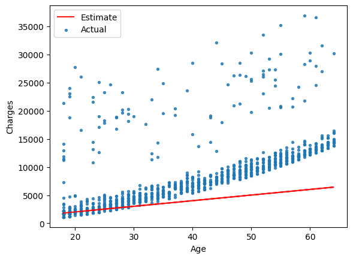
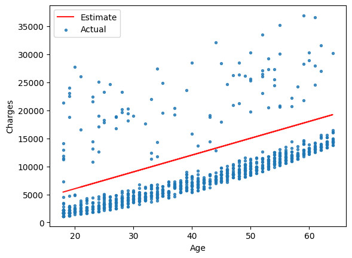

# Дослідження факторів медичних витрат

> **Проєкт із регресійного аналізу · Python · Jupyter Notebook**

## 1. Завдання

Виявити розподіли витрат, перевірити залежність від віку, куріння та інших ознак; порівняти початкові лінійні наближення.

## 2. Що зроблено

Використано Pandas, Plotly, Matplotlib, описову статистику та RMSE. Порівнюються декілька ручних параметризацій прямої.

## 3. Візуальна презентація

### Графік 1

*Візуалізація з результатів оригінального ноутбука. Докладний розрахунок наведено в коді.*

### Графік 2

*Візуалізація з результатів оригінального ноутбука. Докладний розрахунок наведено в коді.*

## 4. Результати

Вихідні результати: RMSE 6 878,52; 5 789,70; 5 199,22 для трьох наборів коефіцієнтів. Це дослідницькі апроксимації, а не оцінка на незалежній тестовій вибірці.

## 5. Практичний висновок

Розподіли медичних витрат та зв’язок ознак з витратами допомагають поставити наступні гіпотези для моделювання.

## 6. Технічна реалізація

- [Відкрити Jupyter Notebook](feature_analysis_medical_charges.ipynb) — дослідження даних, код і діагностика.
- Основні бібліотеки: Python, Pandas, NumPy, Matplotlib / Plotly, scikit-learn; у розширених роботах — statsmodels.
- Для повторного запуску потрібен `medical-charges.csv`. Вихідний CSV у наданих матеріалах відсутній.

**Статус:** адаптований навчальний проєкт для портфоліо. Наведені числові значення взято зі збережених результатів ноутбука; вони не є підтвердженням якості на нових даних без окремого повторного тестування.
