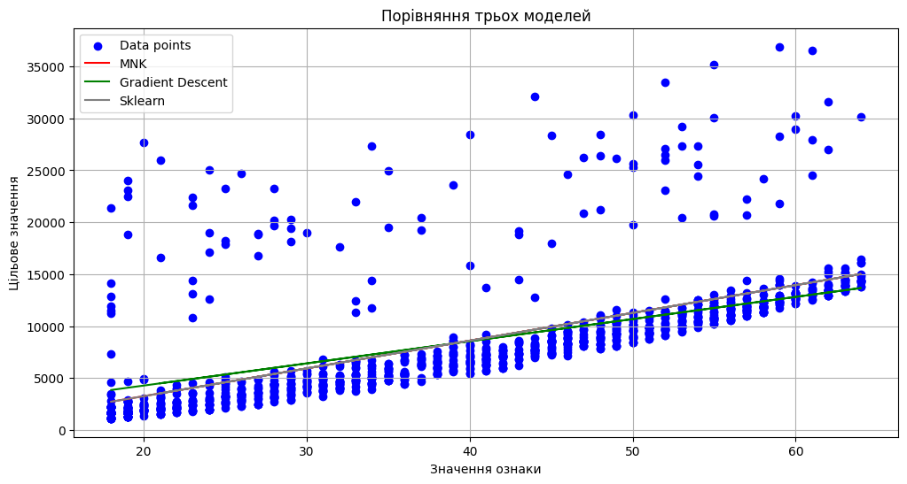
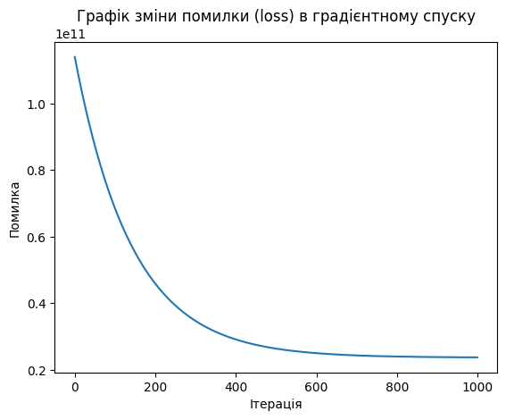
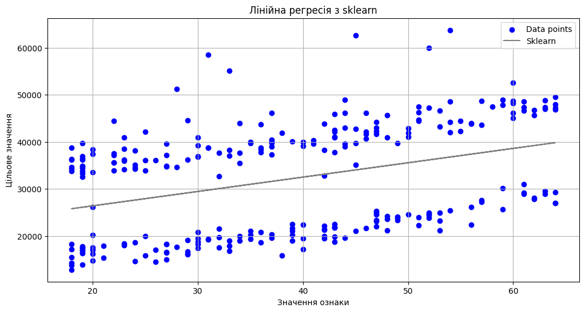

# Прогнозування медичних витрат: проста регресія

> **Проєкт із регресійного аналізу · Python · Jupyter Notebook**

## 1. Завдання

Пояснити, як вік пов’язаний із медичними витратами, та зіставити три способи побудови лінійної моделі.

## 2. Що зроблено

Порівнюються метод нормальних рівнянь, градієнтний спуск та LinearRegression зі scikit-learn; метрика — RMSE.

## 3. Візуальна презентація

### Графік 1

*Візуалізація з результатів оригінального ноутбука. Докладний розрахунок наведено в коді.*

### Графік 2

*Візуалізація з результатів оригінального ноутбука. Докладний розрахунок наведено в коді.*

### Графік 3

*Візуалізація з результатів оригінального ноутбука. Докладний розрахунок наведено в коді.*

## 4. Результати

Для некурців RMSE ≈ 4 662,51 (нормальні рівняння й scikit-learn) проти 4 723,65 (градієнтний спуск). Це оцінка на даних, використаних для побудови моделі, а не підтверджена якість на нових спостереженнях.

## 5. Практичний висновок

Три підходи відтворюють подібну залежність. Для оцінки якості прогнозу на майбутніх пацієнтах потрібна незалежна тестова вибірка.

## 6. Технічна реалізація

- [Відкрити Jupyter Notebook](simple_linear_regression_medical_charges.ipynb) — дослідження даних, код і діагностика.
- Основні бібліотеки: Python, Pandas, NumPy, Matplotlib / Plotly, scikit-learn; у розширених роботах — statsmodels.
- Для повторного запуску потрібен `medical-charges.csv`. Вихідний CSV у наданих матеріалах відсутній.

**Статус:** адаптований навчальний проєкт для портфоліо. Наведені числові значення взято зі збережених результатів ноутбука; вони не є підтвердженням якості на нових даних без окремого повторного тестування.
