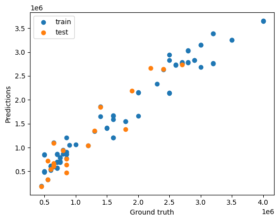
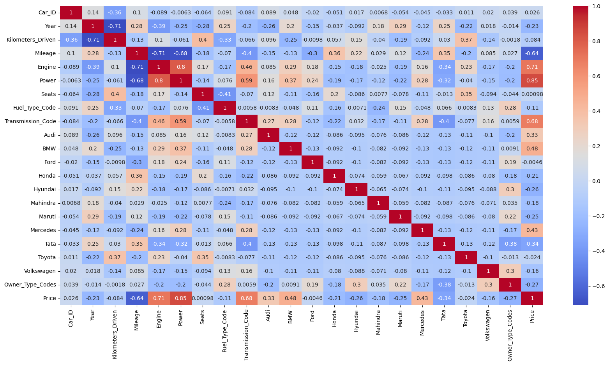

# Оцінювання цін автомобілів: множинна регресія

> **Проєкт із регресійного аналізу · Python · Jupyter Notebook**

## 1. Завдання

Оцінити вартість автомобіля на основі кількох характеристик і зрозуміти, як вибір ознак впливає на прогноз.

## 2. Що зроблено

Використано Pandas, One-hot/числове кодування, масштабування, кореляційну матрицю, LinearRegression і statsmodels.

## 3. Візуальна презентація

### Графік 1

*Візуалізація з результатів оригінального ноутбука. Докладний розрахунок наведено в коді.*

### Графік 2

*Візуалізація з результатів оригінального ноутбука. Докладний розрахунок наведено в коді.*

## 4. Результати

RMSE навчальної вибірки ≈ 210 293,58; тестової ≈ 258 181,56 (в одиницях ціни з вихідного датасету).

## 5. Практичний висновок

Вища помилка на тесті показує, чому не можна орієнтуватися лише на результати навчання.

## 6. Технічна реалізація

- [Відкрити Jupyter Notebook](multiple_linear_regression_cars.ipynb) — дослідження даних, код і діагностика.
- Основні бібліотеки: Python, Pandas, NumPy, Matplotlib / Plotly, scikit-learn; у розширених роботах — statsmodels.
- Для повторного запуску потрібен `cars.csv`. Вихідний CSV у наданих матеріалах відсутній.

**Статус:** адаптований навчальний проєкт для портфоліо. Наведені числові значення взято зі збережених результатів ноутбука; вони не є підтвердженням якості на нових даних без окремого повторного тестування.
