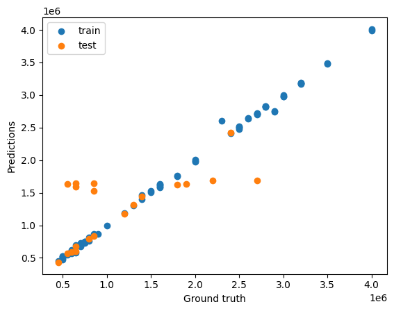
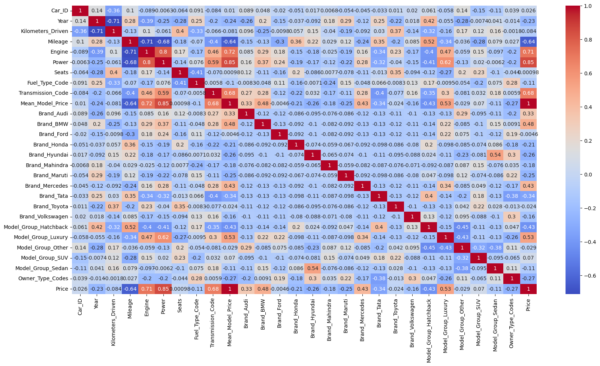
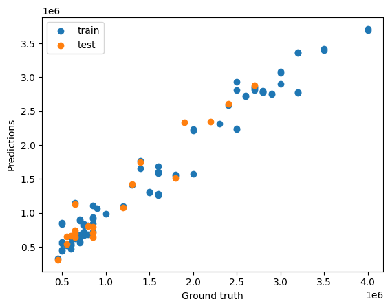

# Оцінювання цін авто: категоріальні ознаки

> **Проєкт із регресійного аналізу · Python · Jupyter Notebook**

## 1. Завдання

Порівняти варіанти прогнозу вартості автомобіля з використанням ознак марки та моделі.

## 2. Що зроблено

Використано кодування категорій, агреговану ознаку середньої ціни моделі, LinearRegression, порівняння train/test та аналіз коефіцієнтів.

## 3. Візуальна презентація

### Графік 1

*Візуалізація з результатів оригінального ноутбука. Докладний розрахунок наведено в коді.*

### Графік 2

*Візуалізація з результатів оригінального ноутбука. Докладний розрахунок наведено в коді.*

### Графік 3

*Візуалізація з результатів оригінального ноутбука. Докладний розрахунок наведено в коді.*

## 4. Результати

В одному варіанті RMSE: train ≈ 47 895,02; test ≈ 526 893,51. Без Mean_Model_Price: train ≈ 192 816,88; test ≈ 207 802,94.

## 5. Практичний висновок

Великий розрив train/test для ознаки Mean_Model_Price вимагає перевірки витоку інформації та способу обчислення агрегатів. Результат без цієї ознаки є стабільнішим за наведеними метриками.

## 6. Технічна реалізація

- [Відкрити Jupyter Notebook](multiple_regression_cars_with_model_features.ipynb) — дослідження даних, код і діагностика.
- Основні бібліотеки: Python, Pandas, NumPy, Matplotlib / Plotly, scikit-learn; у розширених роботах — statsmodels.
- Для повторного запуску потрібен `cars.csv`. Вихідний CSV у наданих матеріалах відсутній.

**Статус:** адаптований навчальний проєкт для портфоліо. Наведені числові значення взято зі збережених результатів ноутбука; вони не є підтвердженням якості на нових даних без окремого повторного тестування.
