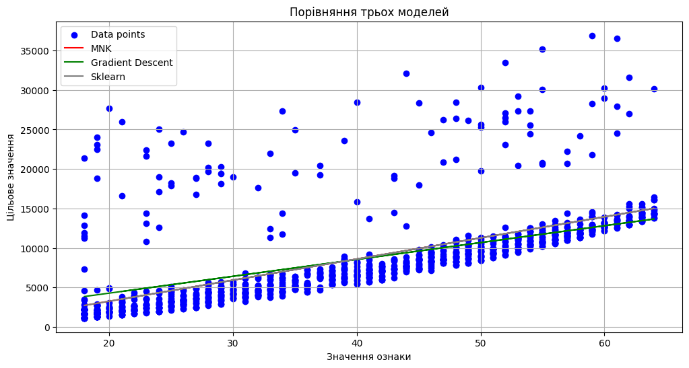
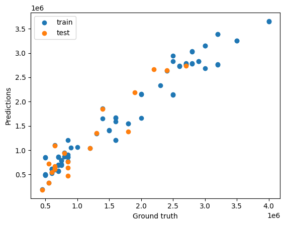
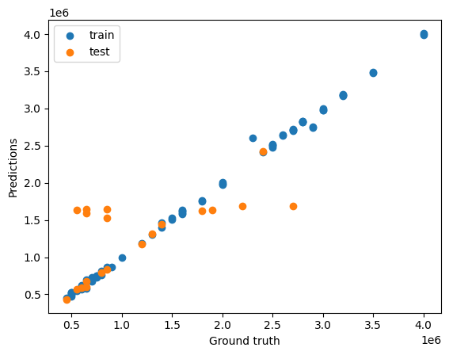

# Регресійний аналіз — портфоліо Python

Чотири дослідження, що демонструють перехід від аналізу ознак до прогнозних моделей. **Кожен проєкт містить коротку візуальну презентацію для HR та окремий технічний Jupyter Notebook.**

## Огляд проєктів

| Проєкт | Бізнес-завдання | Ключовий результат |
|---|---|---|
| [Аналіз медичних витрат](01-feature-analysis/) | Знайти фактори, пов’язані з витратами | Три ручні апроксимації, RMSE 5 199–6 879 |
| [Проста лінійна регресія](02-simple-linear-regression/) | Оцінити витрати за віком | RMSE ≈ 4 662,51 на навчальних даних |
| [Множинна регресія цін авто](03-multiple-linear-regression/) | Прогнозувати ціну за характеристиками | RMSE тесту ≈ 258 181,56 |
| [Категоріальні ознаки авто](04-categorical-feature-engineering/) | Перевірити вплив марки та моделі | RMSE тесту ≈ 207 802,94 без агрегату Mean_Model_Price |

## Візуальні результати

### Проста лінійна регресія

### Множинна регресія для цін автомобілів

### Аналіз розширеної моделі

## Чим це корисно бізнесу

Регресія дає кількісну оцінку зв’язків між показниками та допомагає будувати прогнози. Але показники на навчальних даних можуть бути оптимістичними: особливо уважно слід перевіряти якість на тестовій вибірці та запобігати витоку інформації.

## Як переглядати

1. Відкрийте папку потрібного проєкту — одразу побачите бізнес-завдання, графіки, метрики та висновки.
2. Для перевірки алгоритму відкрийте файл `.ipynb`.
3. Для повного відтворення запуску потрібні початкові датасети `medical-charges.csv` і `cars.csv` (не входили до наданих файлів).

**Походження:** адаптація власних навчальних ноутбуків до формату портфоліо. Результати — з попередніх виконань, не перевірені повторним запуском без CSV.
