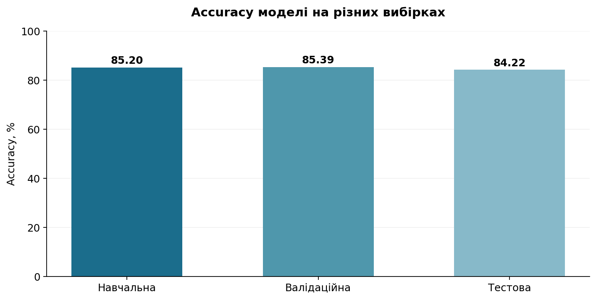
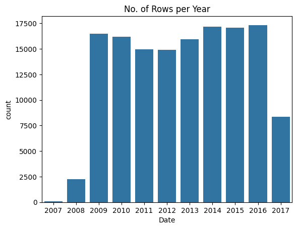
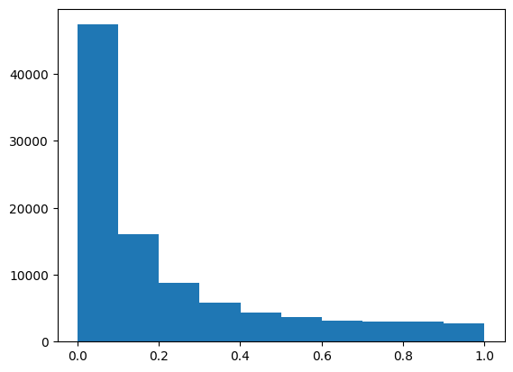
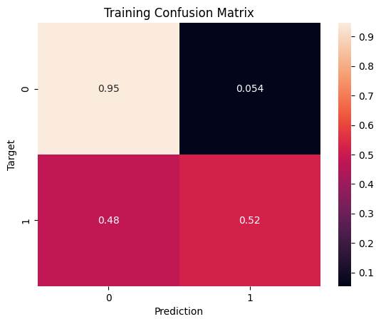

# Прогнозування дощу на основі погодних спостережень

> **Напрям:** Машинне навчання · Класифікація  
> **Інструменти:** Python · Pandas · NumPy · Scikit-learn · Matplotlib (відповідно до конкретного ноутбука)

## Огляд

Бінарна класифікація: передбачити RainTomorrow за метеорологічними показниками Австралії.

## Що досліджено

Логістична регресія, обробка пропусків, MinMaxScaler, OneHotEncoder, матриця помилок, F1, ROC/AUC, Pipeline.

## Результати

| Вибірка | Accuracy | F1 |
|---|---:|---:|
| Навчальна | 85,20% | 0,61 |
| Валідаційна | 85,39% | 0,57 |
| Тестова | 84,22% | 0,58 |

*F1 взято з виведених значень ноутбука. У вихідному коді відсотковий знак біля F1 надруковано помилково: F1 — це коефіцієнт у межах від 0 до 1.*

## Візуалізації

## Інтерпретація

Порівнюємо результати навчальної, валідаційної та тестової вибірок, а не лише якість на навчальних даних.

## Технічна реалізація

- [`weather_prediction.ipynb`](weather_prediction.ipynb) — вихідний аналіз і реалізація алгоритму.

Ноутбуки містять деталізацію підготовки даних, модельних припущень та розрахунків. Для повторного запуску окремих частин потрібні зовнішні файли або доступ до онлайн-датасету. Збережені результати не означають, що всі ноутбуки були повторно виконані в поточному середовищі.

## Джерела й обмеження

Матеріали адаптовано з попередніх навчальних досліджень. Обчислення та збережені результати з оригінальних ноутбуків не підмінено новими. Нові діаграми з метриками побудовано за вже наявними числовими результатами. Посилання на першоджерела датасетів, якщо наявні, наведені всередині ноутбуків.
