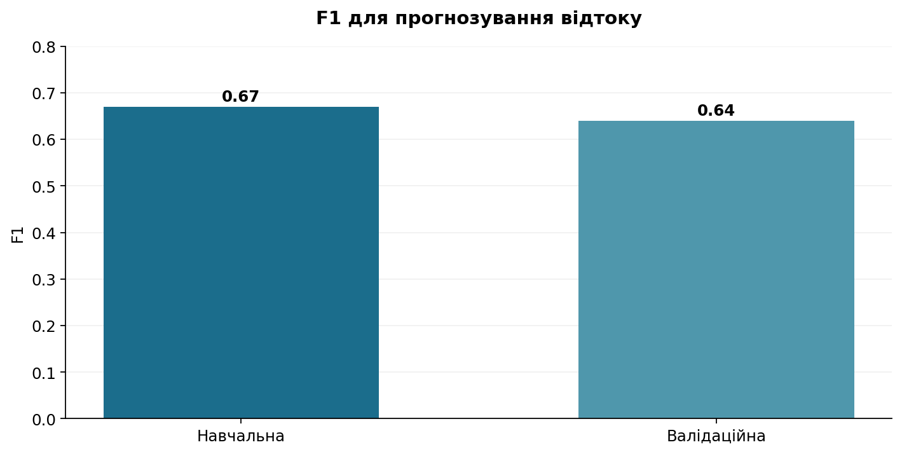
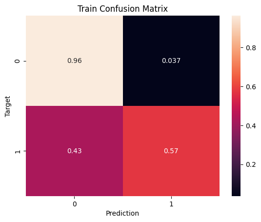
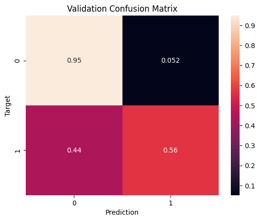

# Прогнозування відтоку банківських клієнтів

> **Напрям:** Машинне навчання · Класифікація  
> **Інструменти:** Python · Pandas · NumPy · Scikit-learn · Matplotlib (відповідно до конкретного ноутбука)

## Огляд

Визначити, чи припинить клієнт користуватися послугами банку (Exited).

## Що досліджено

Підготовка числових і категоріальних ознак, логістична регресія, F1, accuracy, порівняння з наївним прогнозом.

## Результати

| Показник | Значення |
|---|---:|
| F1, навчальна | 0,67 |
| F1, валідаційна | 0,64 |
| Accuracy, валідаційна | 87,0% |
| Accuracy базової моделі «усі залишаються», валідаційна | 79,67% |

## Візуалізації

## Інтерпретація

Accuracy сама по собі не гарантує якісного виявлення відтоку: у наборі переважають клієнти, які залишаються.

## Технічна реалізація

- [`customer_churn.ipynb`](customer_churn.ipynb) — вихідний аналіз і реалізація алгоритму.

Ноутбуки містять деталізацію підготовки даних, модельних припущень та розрахунків. Для повторного запуску окремих частин потрібні зовнішні файли або доступ до онлайн-датасету. Збережені результати не означають, що всі ноутбуки були повторно виконані в поточному середовищі.

## Джерела й обмеження

Матеріали адаптовано з попередніх навчальних досліджень. Обчислення та збережені результати з оригінальних ноутбуків не підмінено новими. Нові діаграми з метриками побудовано за вже наявними числовими результатами. Посилання на першоджерела датасетів, якщо наявні, наведені всередині ноутбуків.
