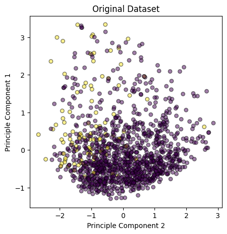
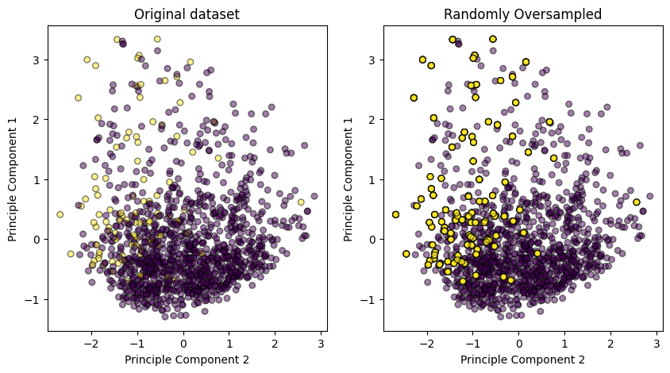
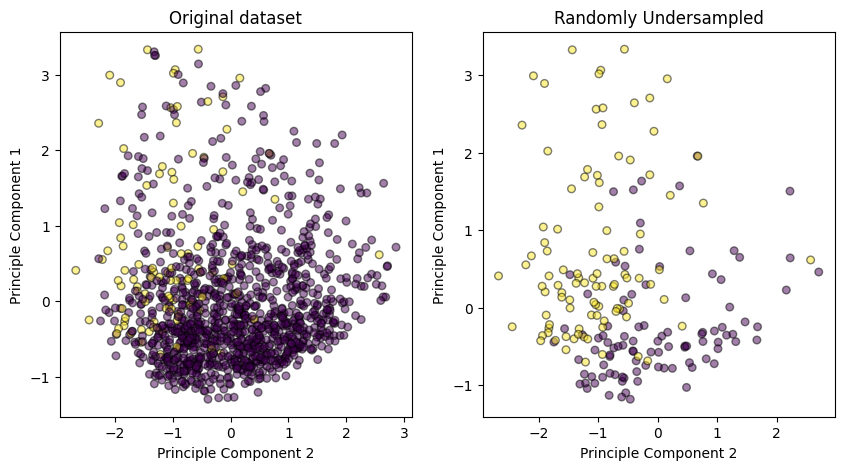

# Робота з дисбалансом класів

> **Напрям:** Машинне навчання · Класифікація  
> **Інструменти:** Python · Pandas · NumPy · Scikit-learn · Matplotlib (відповідно до конкретного ноутбука)

## Огляд

Дослідити, як змінюється поведінка класифікаторів при нерівномірній представленості класів.

## Що досліджено

RandomOverSampler, RandomUnderSampler, ADASYN, SMOTE, SMOTE-Tomek, SVC, One-vs-Rest, PCA, ROC.

## Результати

У матеріалах порівнюються базові дані з процедурами ресемплінгу та якість класифікації за кількома класами. Оскільки ноутбуки не надають єдиної підсумкової метрики для двох різних датасетів, результати не зводяться до одного вигаданого числа.

## Візуалізації

## Інтерпретація

Метрики необхідно оцінювати на недоторканій тестовій вибірці: ресемплінг лише навчальних даних.

## Технічна реалізація

- [`crime_class_imbalance.ipynb`](crime_class_imbalance.ipynb) — вихідний аналіз і реалізація алгоритму.
- [`customer_segmentation_imbalance.ipynb`](customer_segmentation_imbalance.ipynb) — вихідний аналіз і реалізація алгоритму.

Ноутбуки містять деталізацію підготовки даних, модельних припущень та розрахунків. Для повторного запуску окремих частин потрібні зовнішні файли або доступ до онлайн-датасету. Збережені результати не означають, що всі ноутбуки були повторно виконані в поточному середовищі.

## Джерела й обмеження

Матеріали адаптовано з попередніх навчальних досліджень. Обчислення та збережені результати з оригінальних ноутбуків не підмінено новими. Нові діаграми з метриками побудовано за вже наявними числовими результатами. Посилання на першоджерела датасетів, якщо наявні, наведені всередині ноутбуків.
