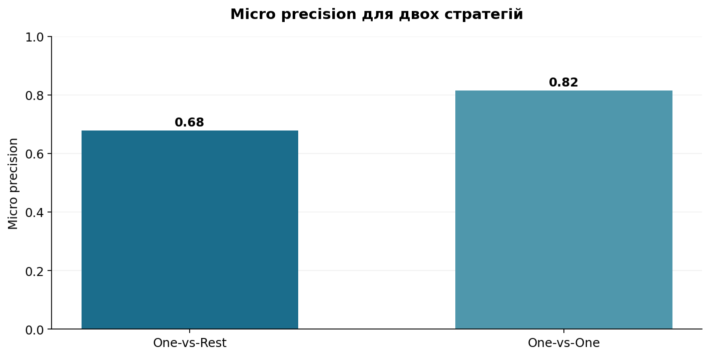

# Багатокласова та мультилейбл-класифікація

> **Напрям:** Машинне навчання · Класифікація  
> **Інструменти:** Python · Pandas · NumPy · Scikit-learn · Matplotlib (відповідно до конкретного ноутбука)

## Огляд

Порівняти стратегії One-vs-Rest та One-vs-One для задачі з кількома класами й розглянути мультилейбл-випадок.

## Що досліджено

LogisticRegression, OneVsRestClassifier, OneVsOneClassifier, precision, recall, macro/micro усереднення.

## Результати

| Стратегія | Macro precision | Micro precision |
|---|---:|---:|
| One-vs-Rest | 0,667 | 0,679 |
| One-vs-One | 0,813 | 0,816 |

Показники взято зі збереженого результату ноутбука. Порівняння стосується саме наведеного набору та налаштувань.

## Візуалізації

## Інтерпретація

Різниця стратегій оцінюється за метриками, а не за складністю назв алгоритмів.

## Технічна реалізація

- [`multiclass_and_multilabel.ipynb`](multiclass_and_multilabel.ipynb) — вихідний аналіз і реалізація алгоритму.

Ноутбуки містять деталізацію підготовки даних, модельних припущень та розрахунків. Для повторного запуску окремих частин потрібні зовнішні файли або доступ до онлайн-датасету. Збережені результати не означають, що всі ноутбуки були повторно виконані в поточному середовищі.

## Джерела й обмеження

Матеріали адаптовано з попередніх навчальних досліджень. Обчислення та збережені результати з оригінальних ноутбуків не підмінено новими. Нові діаграми з метриками побудовано за вже наявними числовими результатами. Посилання на першоджерела датасетів, якщо наявні, наведені всередині ноутбуків.
