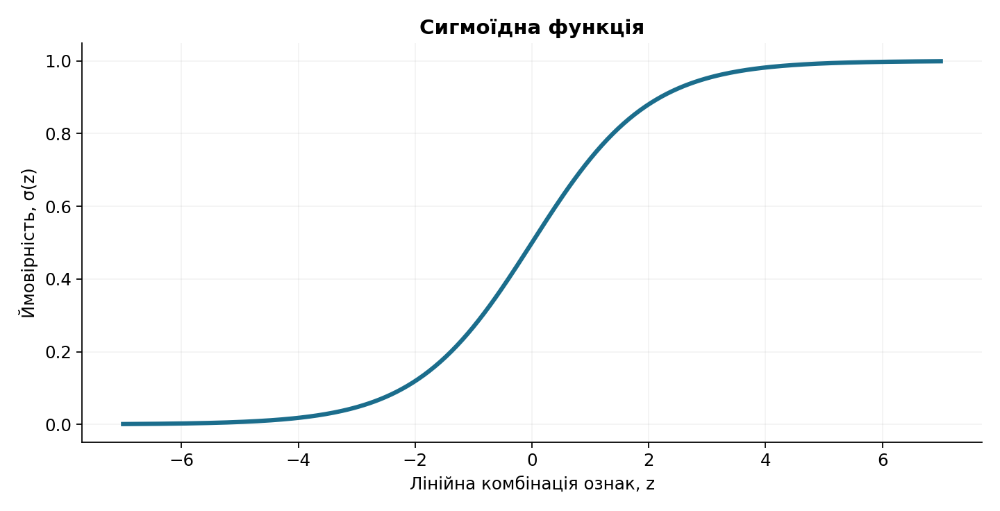

# Математика логістичної регресії та реалізація на NumPy

> **Напрям:** Машинне навчання · Класифікація  
> **Інструменти:** Python · Pandas · NumPy · Scikit-learn · Matplotlib (відповідно до конкретного ноутбука)

## Огляд

Показати логіку бінарної класифікації через sigmoid, логістичну функцію втрат та градієнтний спуск.

## Що досліджено

NumPy, sigmoid, binary cross-entropy, обчислення градієнтів, full-batch gradient descent.

## Результати

У короткому демонстраційному прикладі з чотирьох спостережень виведено точність 0,50. Це ілюстрація розрахунку, а не надійна оцінка узагальнення моделі.

## Візуалізації

## Інтерпретація

Це демонстрація математичного механізму, а не незалежно протестована промислова модель.

## Технічна реалізація

- [`logistic_regression_numpy.ipynb`](logistic_regression_numpy.ipynb) — вихідний аналіз і реалізація алгоритму.
- [`logistic_loss_theory.ipynb`](logistic_loss_theory.ipynb) — вихідний аналіз і реалізація алгоритму.

Ноутбуки містять деталізацію підготовки даних, модельних припущень та розрахунків. Для повторного запуску окремих частин потрібні зовнішні файли або доступ до онлайн-датасету. Збережені результати не означають, що всі ноутбуки були повторно виконані в поточному середовищі.

## Джерела й обмеження

Матеріали адаптовано з попередніх навчальних досліджень. Обчислення та збережені результати з оригінальних ноутбуків не підмінено новими. Нові діаграми з метриками побудовано за вже наявними числовими результатами. Посилання на першоджерела датасетів, якщо наявні, наведені всередині ноутбуків.
