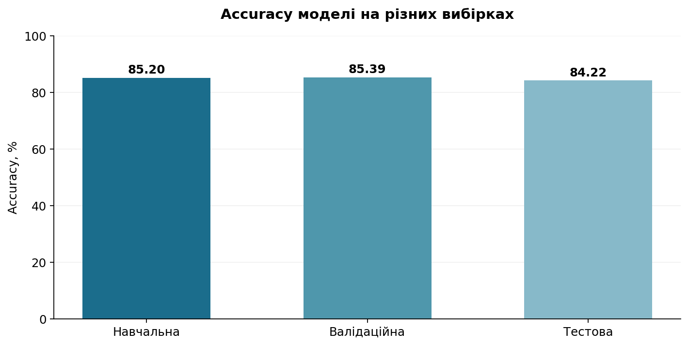
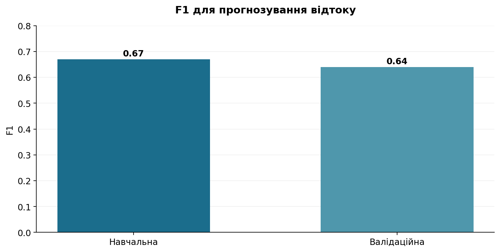
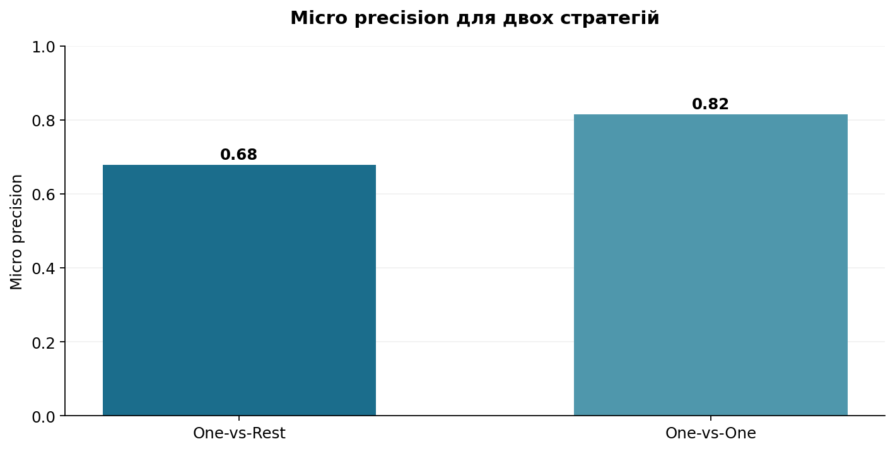

# Класифікація — портфоліо машинного навчання

## Про розділ

П'ять практичних досліджень: від прогнозування бінарної події до роботи з дисбалансом класів, порівняння багатокласових стратегій і реалізації логістичної регресії з базових математичних операцій.

У кожному проєкті є короткий опис задачі, графіки, виміряні результати та технічні ноутбуки. Усі матеріали подано українською у вступних документах. Сам код збережено близьким до вихідного; частина внутрішніх коментарів та підписів графіків може залишатися англійською.

## Швидкий огляд

| Проєкт | Задача | Ключовий результат |
|---|---|---|
| [Прогнозування дощу](01-weather-prediction/) | Бінарна класифікація | Accuracy тестової вибірки **84,22%** |
| [Відтік клієнтів](02-customer-churn/) | Прогнозування відтоку | F1 на валідації **0,64** |
| [Дисбаланс класів](03-class-imbalance/) | Oversampling, undersampling, SMOTE | Порівняння методів на двох наборах |
| [Багатокласова класифікація](04-multiclass-classification/) | OvR / OvO | Micro precision **0,679 / 0,816** |
| [Математика логістичної регресії](05-logistic-regression-from-scratch/) | Sigmoid, log-loss, градієнтний спуск | Реалізація на NumPy |

## Результати моделей

### Прогноз дощу

### Прогноз відтоку

### Порівняння стратегій класифікації

## Практичні висновки

- Для незбалансованих даних важливо аналізувати F1, precision та recall, а не покладатися лише на accuracy.
- Якість моделі треба перевіряти на даних, які не використовувалися для навчання.
- Прості зрозумілі моделі корисні як базова точка відліку, з якою можна порівнювати складніші підходи.
- Графіки та метрики нижче відображають збережені результати вихідних ноутбуків; окремі розрахунки можуть потребувати зовнішніх файлів для повторного виконання.

## Структура

Кожна папка містить власний `README.md`, ноутбуки `.ipynb` і папку `figures/` з ілюстраціями. За потреби додаткові матеріали та датасети можуть бути включені пізніше з дотриманням умов ліцензування джерел.
