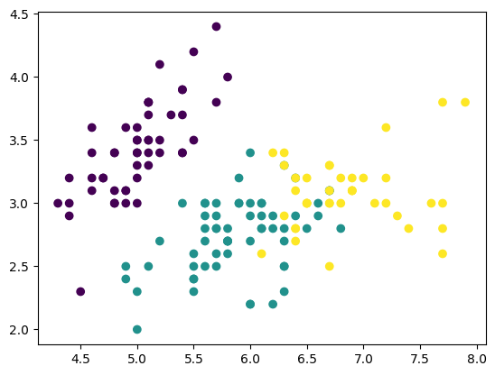
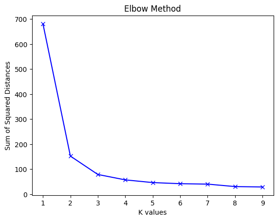
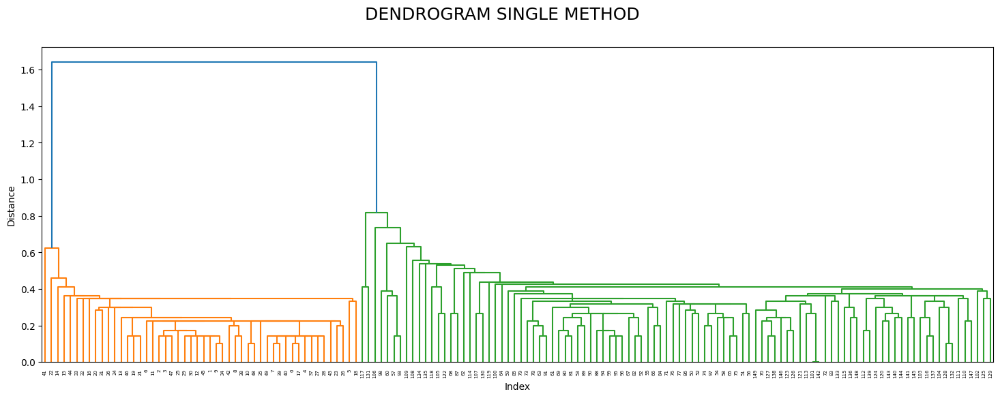
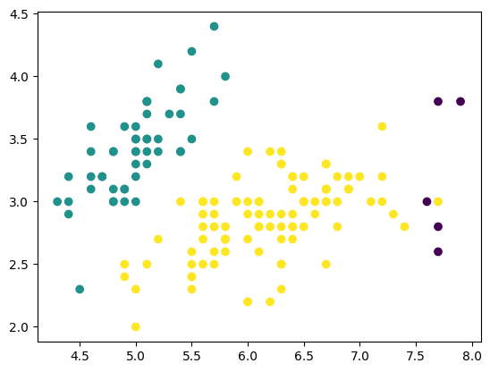
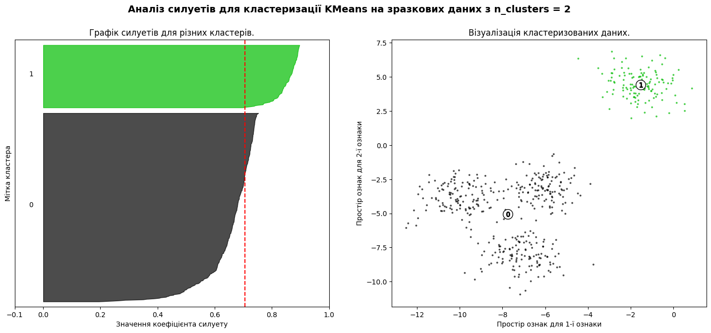

# Кластеризація ірисів: порівняння K-Means, ієрархічних методів та DBSCAN

## Постановка задачі

Мета дослідження — **виявити групи подібних об’єктів без використання готових класів**. Для порівняння застосовано набір даних Iris із чотирма кількісними характеристиками квіток. Відомі назви видів використано тільки для інтерпретації результатів.

## Дані та методи

| Компонент | Опис |
|---|---|
| Набір даних | Iris, 150 спостережень, 4 числові ознаки |
| Алгоритми | K-Means, ієрархічна кластеризація, DBSCAN |
| Підбір параметрів | Метод ліктя, аналіз силуету |
| Аналіз | Візуалізація кластерів, дендрограми, порівняння з фактичними видами |
| Бібліотеки | pandas, matplotlib, seaborn, scikit-learn, scipy |

## Візуальний аналіз

## Що показали результати

- **K-Means:** досліджено поділ на три кластери; метод ліктя використано для оцінювання доцільної кількості груп.
- **Ієрархічна кластеризація:** порівняно одиночне та повне з’єднання, дендрограми й інтерпретацію характеристик груп.
- **DBSCAN:** продемонстровано кластеризацію за щільністю та позначення шумових спостережень міткою `-1`.
- **Аналіз силуету:** досліджено, як вибір числа кластерів впливає на якість сегментації; окремий приклад виконано на синтетичних даних `make_blobs`.

**Інтерпретація:** частина груп Iris добре відокремлюється за вимірами пелюсток, однак кластери не обов’язково точно повторюють ботанічні види. Це нормальна властивість навчання без учителя.

## Обмеження

- Iris — невеликий навчальний набір даних; результати не можна автоматично переносити на бізнес-дані.
- Вихідний ноутбук порівнює методи переважно на немасштабованих числових ознаках. Евклідова відстань залежить від масштабу ознак.
- Вибір `eps` для DBSCAN та кількості кластерів для K-Means потребує додаткової перевірки на інших наборах даних.
- Графіки взято зі збережених результатів ноутбука; повне повторне виконання всіх комірок у цьому пакеті не проводилось.

## Технічна реалізація

[Переглянути Jupyter Notebook](iris_clustering.ipynb) · [Відкрити в Google Colab](https://colab.research.google.com/)

Для запуску: встановити пакети з `requirements.txt`, відкрити `.ipynb` у Colab або Jupyter та послідовно виконати комірки. Датасет Iris завантажується через `sklearn.datasets.load_iris` — окремий CSV не потрібен.

**Походження:** проєкт адаптовано з навчального ноутбука для демонстрації методів кластеризації.
