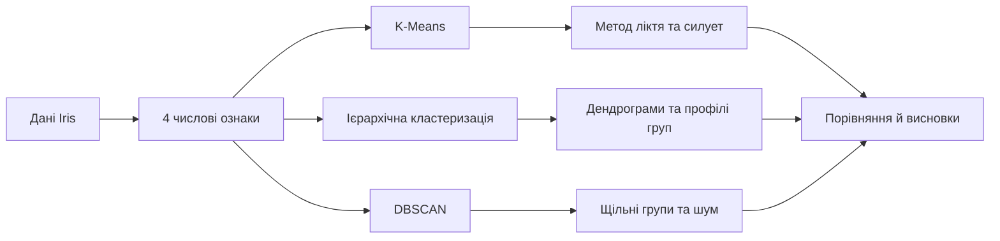
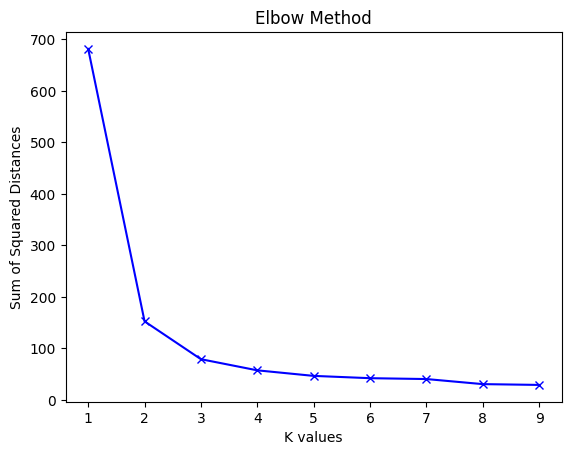
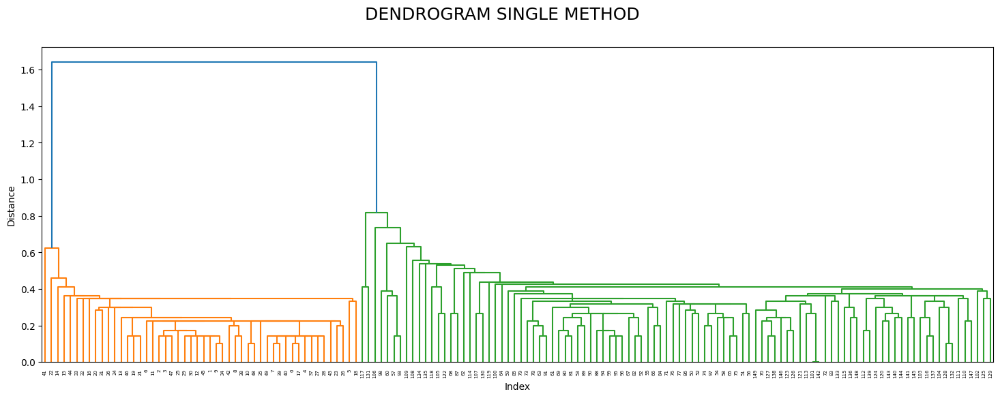
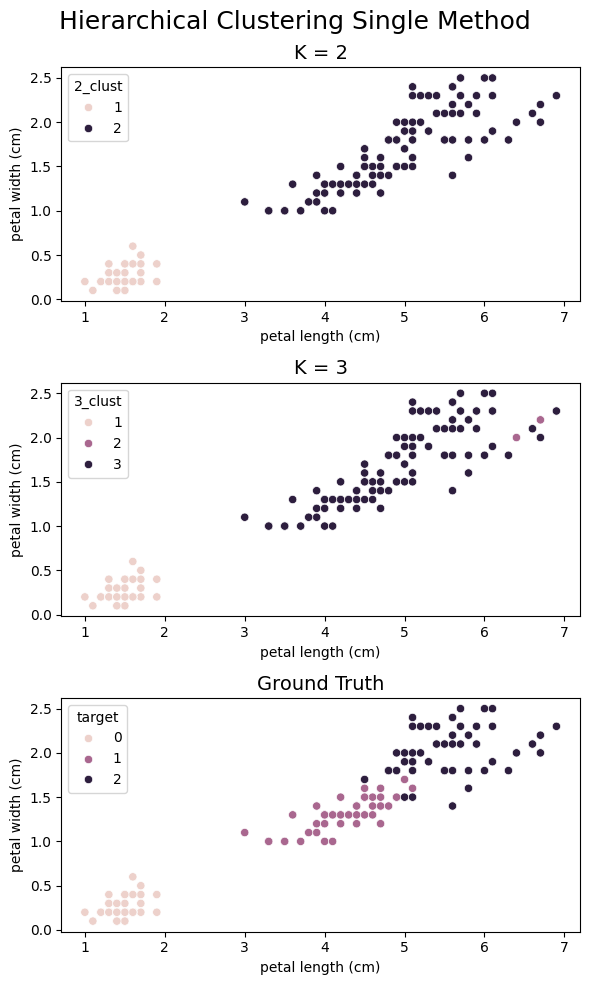
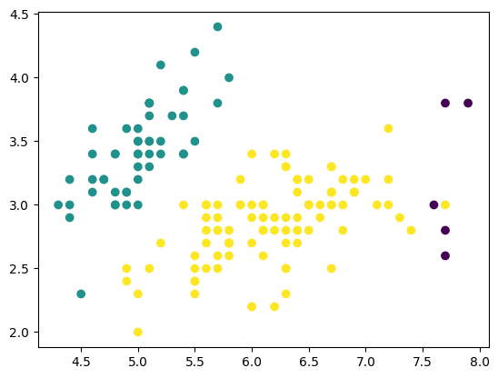
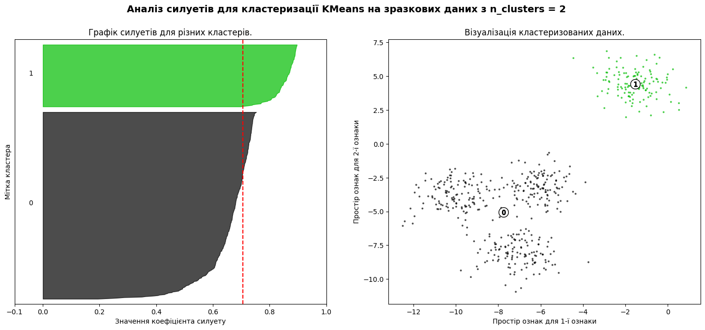

# Кластеризація даних: K-Means, ієрархічні методи та DBSCAN

**Дослідження алгоритмів навчання без учителя на наборі Iris**  
`Python` · `Scikit-learn` · `SciPy` · `Pandas` · `Matplotlib` · `Seaborn`

> **Мета:** дослідити, чи можна знайти природні групи спостережень за числовими характеристиками, не використовуючи під час побудови кластерів відомі класи об'єктів. Порівняти способи групування, візуалізувати результати й проаналізувати обмеження кожного підходу.

## Коротко про дослідження

| Показник | Результат |
|:--|:--|
| Основний набір даних | Iris — **150 квіток, 4 числові ознаки, 3 відомі види** |
| K-Means | **3 кластери**, коефіцієнт силуету **0,55** |
| DBSCAN (`eps=0.8`, `min_samples=10`) | **2 кластери, 5 шумових точок**, силует **0,53** |
| Ієрархічний підхід | Порівняно `single linkage` та `complete linkage`, розбиття на **2 і 3 групи** |
| Додатковий експеримент | **500 синтетичних спостережень**, порівняння `k = 2…6` за силуетом |

**Основний результат.** На Iris алгоритми знаходять різну структуру груп: K-Means формує три кластери за заданим `k`, тоді як DBSCAN з вибраними параметрами виділяє дві щільні групи та шумові спостереження. Отже, кількість і форма кластерів залежать не лише від даних, а й від методу та його параметрів.


*На рисунку — результат K-Means у двовимірній проєкції за довжиною та шириною чашолистка. Сама модель використовує всі чотири числові ознаки, тому проєкція не показує повністю чотиривимірне розділення.*

---

## 1. Постановка задачі

Кластеризація — метод **навчання без учителя (unsupervised learning)**: алгоритм отримує ознаки об'єктів, але не отримує правильних міток класів як цільову змінну.

У цьому дослідженні потрібно:

1. Підготувати числові характеристики рослин ірису.
2. Побудувати кластери за допомогою **K-Means**.
3. Перевірити обґрунтованість кількості кластерів **методом ліктя**.
4. Дослідити ієрархічне групування методами **Single Linkage** та **Complete Linkage**.
5. Знайти групи підвищеної щільності й шумові точки за допомогою **DBSCAN**.
6. Порівняти якість сегментації за **коефіцієнтом силуету**.

У наборі Iris уже є відомі ботанічні види. Вони використовуються **лише для інтерпретації й зіставлення результатів** — не як навчальні мітки для кластеризаторів.

### Робочий процес



## 2. Набір даних

**Iris** містить 150 спостережень і чотири характеристики в сантиметрах:

| Ознака в даних | Українською | Інтерпретація |
|:--|:--|:--|
| `sepal length (cm)` | Довжина чашолистка | Геометричний розмір чашолистка |
| `sepal width (cm)` | Ширина чашолистка | Додаткова характеристика чашолистка |
| `petal length (cm)` | Довжина пелюстки | Геометричний розмір пелюстки |
| `petal width (cm)` | Ширина пелюстки | Додаткова характеристика пелюстки |

Відомі види — *setosa*, *versicolor* і *virginica*. Під час кластеризації модель працює з матрицею ознак `X`; мітка виду (`target`) не входить до цієї матриці.

**Практичний зміст:** такий самий підхід можна використати для сегментації клієнтів, товарів або торгових точок за кількісними характеристиками. Це потенційні сценарії використання методу, а не результати цього дослідження.

---

## 3. K-Means: поділ на три групи

K-Means намагається розділити спостереження на `k` груп так, щоб усередині груп об'єкти були якомога ближчими до своїх центрів — **центроїдів**.

У ноутбуці застосовано `KMeans(n_clusters=3, n_init='auto')` до всіх чотирьох числових ознак.

### Як працює алгоритм

1. Ініціалізує три центри.
2. Відносить кожну квітку до найближчого центру.
3. Перераховує центри за поточним складом груп.
4. Повторює кроки до збіжності.

**Результат:** отримано **3 кластери**, коефіцієнт силуету становить **0,55**. Значення свідчить про помітну структуру кластерів, але не про ідеальне розділення всіх трьох ботанічних видів.


*Однаковий колір означає призначення до одного кластера. Номери та кольори кластерів умовні й не відповідають автоматично назвам видів.*

### Метод ліктя: скільки кластерів обрати?

Для `k` від 1 до 9 у ноутбуці обчислено **inertia** — суму квадратів відстаней від кожного об'єкта до центру його кластера. Зі збільшенням `k` значення зазвичай зменшується, тому важливо знайти точку, після якої покращення стає менш суттєвим.



**Інтерпретація:** у вихідному дослідженні за характером кривої запропоновано **`k = 3`**. Метод ліктя — графічна евристика, а не математичний доказ оптимальності цього значення. Додаткову інформацію дає силуетний аналіз.

---

## 4. Ієрархічна кластеризація: зв'язки між спостереженнями

На відміну від K-Means, ієрархічна агломеративна кластеризація починає з окремих об'єктів і послідовно об'єднує найближчі групи. Послідовність злиттів зображається **дендрограмою**.

### 4.1 Single Linkage — найближчі точки

Відстань між двома кластерами визначається як **мінімальна** відстань між будь-якими двома їхніми точками. Підхід може утворювати довгі ланцюжки пов'язаних спостережень.



**Що видно:** у ноутбуці дендрограму інтерпретовано як чітке виділення двох основних груп. Порівняння розбиття на 2 та 3 кластери показало, що додаткова третя група за цим способом об'єднання не дає настільки ж виразного розділення.

### 4.2 Complete Linkage — найдальші точки

Відстань між кластерами визначається за **максимальною** відстанню між їхніми точками. Такий підхід зазвичай сильніше стримує утворення довгих витягнутих кластерів.

У ноутбуці розглянуто розбиття на 2 й 3 групи та зіставлено результати з відомими видами ірисів.



**Висновок із вихідного аналізу:** за `k = 3` метод Complete Linkage виділяє *setosa* в окремий кластер, а два інші види розділяються менш однозначно. Групи також інтерпретовано через середні розміри пелюсток і чашолистків: від більших до менших квіток.

**Важливе зауваження:** дендрограма показує структуру злиття, а не автоматично встановлює правильне число кластерів. Порогове значення розрізу потрібно обирати з огляду на завдання.

---

## 5. DBSCAN: кластери за щільністю

**DBSCAN** формує групи в областях достатньої щільності та може позначати ізольовані точки як шум. Він не потребує заздалегідь заданого числа кластерів.

Параметри експерименту:

| Параметр | Значення | Що означає |
|:--|:--:|:--|
| `eps` | `0.8` | Радіус сусідства |
| `min_samples` | `10` | Мінімальна кількість точок у сусідстві для ядрової точки, включно з нею |

**Результат ноутбука:**

| Метрика | Значення |
|:--|--:|
| Знайдені кластери | **2** |
| Шумові точки (`label = -1`) | **5** |
| Коефіцієнт силуету, розрахований у ноутбуці | **0,53** |



*DBSCAN знаходить щільні області. П'ять спостережень, що не належать жодному кластеру за вибраними параметрами, отримують мітку `-1`.*

**Інтерпретація:** DBSCAN і K-Means дають різну кількість груп не через помилку, а через різні припущення про форму й щільність кластерів. Значення `eps` і `min_samples` істотно впливають на результат.

> **Методологічне уточнення:** показник силуету `0,53` відтворено зі збереженого розрахунку, у якому мітка шуму `-1` також бере участь в обчисленні. Тому пряме порівняння цього показника з `0,55` для K-Means має обмеження. Для строгого порівняння слід заздалегідь узгодити правила оцінювання шумових точок.

---

## 6. Silhouette Analysis: оцінка структури кластерів

Коефіцієнт силуету показує, наскільки об'єкт схожий на інші точки **свого** кластера порівняно з точками **найближчого іншого** кластера.

\[
s(i) = \frac{b(i)-a(i)}{\max\{a(i),b(i)\}}
\]

де `a(i)` — середня відстань об'єкта до точок свого кластера, а `b(i)` — найменша середня відстань до точок іншого кластера.

- **Близько до 1:** об'єкт добре відокремлений від інших кластерів.
- **Близько до 0:** об'єкт перебуває поблизу межі між групами.
- **Менше 0:** об'єкт може бути ближчим до іншого кластера, ніж до власного.

### Окремий експеримент на синтетичних даних

Щоб детальніше дослідити силуетний показник, у ноутбуці створено **500 двовимірних синтетичних спостережень** (`make_blobs`, 4 центри, `random_state=1`). Далі перевірено K-Means для різної кількості груп.

| Кількість кластерів `k` | Середній силует |
|:--:|--:|
| **2** | **0,7050** |
| 3 | 0,5882 |
| **4** | **0,6505** |
| 5 | 0,5615 |
| 6 | 0,4858 |



**Як читати графік:** товщина смуг допомагає оцінити чисельність груп, а їхня довжина — якість відокремлення об'єктів. На цьому прикладі `k = 2` має найвищий середній силует, проте `k = 4` краще відповідає чотирьом центрам генерації та дає більш збалансовані групи. Отже, **підбирати кількість кластерів лише за максимальним середнім силуетом не завжди достатньо**.

**Примітка:** значення в таблиці отримані **на синтетичних даних**, не на Iris. Їх не можна порівнювати як результати того самого набору з метриками 0,55 та 0,53 вище.

---

## 7. Порівняння підходів

| Метод | Що задаємо | Сильна сторона | Обмеження | Що показав експеримент |
|:--|:--|:--|:--|:--|
| **K-Means** | Число `k` | Простий, зрозумілі центроїди | Чутливий до масштабу ознак та форми груп | 3 кластери, силует 0,55 |
| **Single Linkage** | Правило злиття / поріг розрізу | Виявляє пов'язані структури | Ефект ланцюжка | Виразний поділ на дві основні групи |
| **Complete Linkage** | Правило злиття / поріг розрізу | Компактніші групи | Чутливість до віддалених точок | Порівняно 2 та 3 групи |
| **DBSCAN** | `eps`, `min_samples` | Знаходить шум і групи довільної форми | Чутливий до параметрів і різної щільності | 2 кластери, 5 шумових точок |

### Ключові висновки

1. **Алгоритм визначає характер сегментації.** Різні методи можуть показувати різні, але змістовні способи групування одних і тих самих даних.
2. **Три ботанічні види не гарантують трьох природних кластерів.** Групування за відстанями не тотожне класифікації за відомими назвами.
3. **Кількість груп треба аргументувати.** Метод ліктя, дендрограми, силует та інтерпретованість кластерів доповнюють один одного.
4. **Візуалізація двох ознак не замінює аналіз усіх чотирьох.** На графіку групи можуть перекриватися навіть за наявності структури у повному просторі ознак.
5. **Перш ніж застосовувати модель у реальному проєкті, слід перевірити масштабування, стабільність параметрів та зміст отриманих груп.**

## 8. Обмеження дослідження

- Iris — невеликий і добре відомий набір даних, тому результати не підтверджують якість сегментації на великих або незбалансованих бізнес-даних.
- У вихідному ноутбуці основні алгоритми застосовано до **немасштабованих** ознак; евклідова відстань залежить від одиниць та діапазонів вимірювання.
- Для K-Means у вихідній реалізації не задано фіксований `random_state`, тому при повторному запуску окремі мітки або числові оцінки можуть змінюватися.
- Дослідження порівнює алгоритми та демонструє способи аналізу, але не містить повної процедури перевірки стійкості кластерів на нових даних.
- Показники наведено зі збережених результатів ноутбука; вони не є новими експериментами.

## 9. Технічна реалізація

**[Відкрити ноутбук із кодом та розрахунками](01-iris-clustering/iris_clustering.ipynb)**  
**[Переглянути залежності Python](01-iris-clustering/requirements.txt)**

Дані Iris завантажуються безпосередньо із `scikit-learn` через `load_iris(as_frame=True)`; окремий CSV для цього експерименту не потрібен.

**Структура проєкту:**

```text
03-clustering/
├── README.md                # Огляд, результати та графіки
└── 01-iris-clustering/
    ├── iris_clustering.ipynb # Код і дослідження
    ├── requirements.txt
    └── figures/             # Збережені візуалізації
```

Усі числові результати та висновки про поведінку алгоритмів у цьому README ґрунтуються на наданому ноутбуці. Опис можливих бізнес-застосувань є прикладом потенційного використання методів, а не підтвердженим результатом на бізнес-даних.
