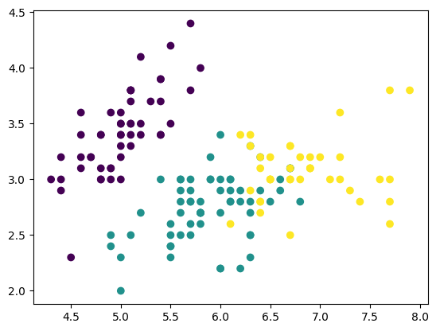

# Кластеризація — Machine Learning

Дослідження алгоритмів навчання без учителя, сегментації даних та оцінювання структури кластерів.

## Проєкти

### [01. Кластеризація ірисів: K-Means, ієрархічні методи та DBSCAN](01-iris-clustering/README.md)

Дослідження 150 спостережень із набору Iris: порівняння алгоритмів, дендрограми, метод ліктя, коефіцієнт силуету та візуалізація груп.

**Технології:** Python, Pandas, Scikit-learn, SciPy, Matplotlib, Seaborn.
