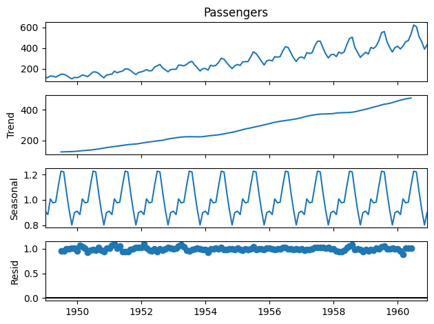
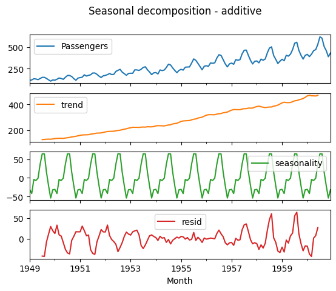
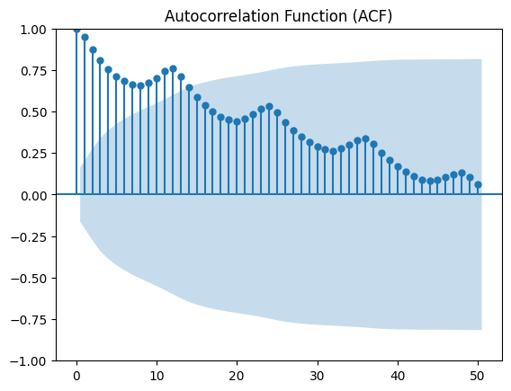
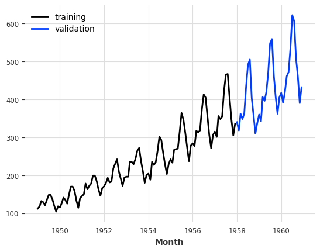
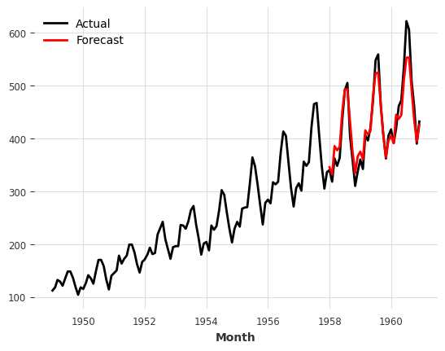
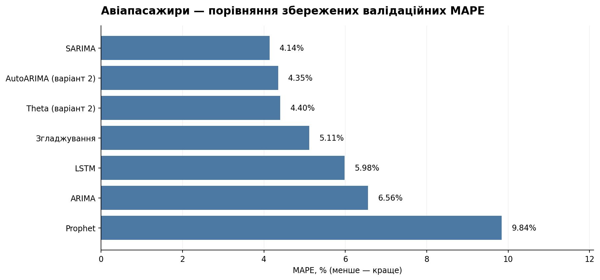
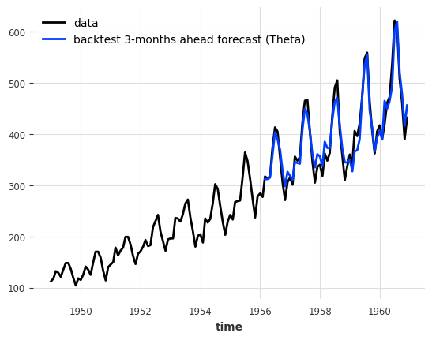
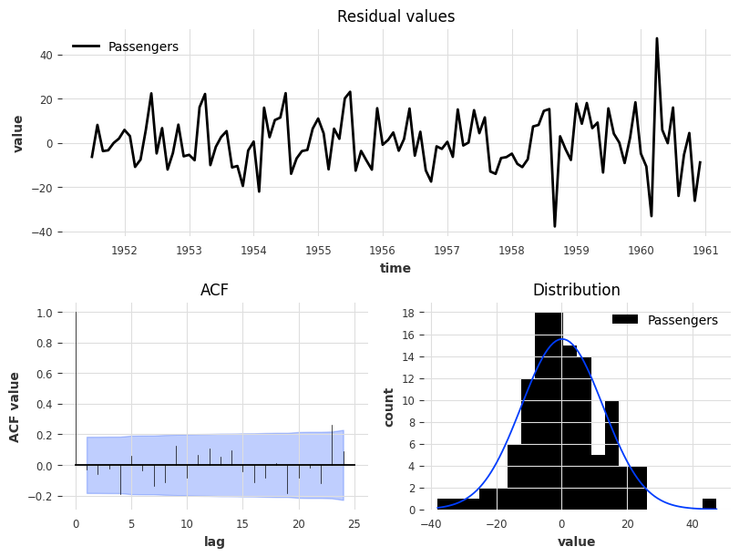

# Авіапасажиропотік: аналіз сезонності та прогнозування

## Підсумок дослідження

**Питання:** як на основі попередніх місячних обсягів пасажиропотоку спрогнозувати навантаження на майбутні періоди?

**Підхід:** аналіз сезонності, порівняння статистичних моделей та методів машинного навчання, перевірка прогнозу на пізніших періодах.

**Результат зі збереженого виконання:** SARIMA (1,1,1) × (1,1,1,12) — **MAPE 4,14%** на валідації. Це результат одного експерименту, не гарантія аналогічної точності на нових даних.

## Дизайн експерименту

**Набір:** 144 місячні спостереження за 1949–1960 роки. **Ціль:** `Passengers`. **Валідація:** часовий відрізок із 1958 року. **Метрики:** MAPE, аналіз залишків і історичне тестування. Порівнюємо базові методи, ARIMA/SARIMA, Prophet, Theta, LSTM та інші підходи, представлені в ноутбуці.

## Візуальний огляд результатів

### Тренд і сезонність

*Сезонні піки збільшуються разом із трендом, тому мультиплікативне представлення допомагає зрозуміти структуру даних.*

### Альтернативна адитивна декомпозиція

*Адитивна схема припускає приблизно постійну сезонну амплітуду; порівняння з мультиплікативною підказує, яка гіпотеза краще відповідає ряду.*

### Автокореляція

*Залежність між поточним місяцем і попередніми значеннями обґрунтовує використання лагових і сезонних моделей.*

### Навчальна та валідаційна частини

*Прогнозування оцінюється на пізніших датах, щоб не використовувати майбутні значення під час навчання.*

### Прогноз SARIMA

*Візуальна оцінка того, наскільки сезонна модель відстежує форму та рівень відкладеного ряду.*

### Порівняння похибок моделей

*Чим нижча MAPE, тим менша середня відносна помилка. Дані діаграми взяті зі збережених результатів; пошук параметрів у моделей різнився.*

### Історична перевірка прогнозу

*Повторні прогнози з різних точок часу допомагають виявити нестійкість точності.*

### Діагностика залишків

*Залишки вказують, чи модель систематично недооцінює або переоцінює окремі періоди.*

## Основні висновки та обмеження

- Сезонні закономірності слід враховувати під час прогнозування пасажиропотоку.
- SARIMA у збереженому експерименті дає 4,14% MAPE, але результати не були повторно відтворені в новому середовищі.
- Прогноз стосується історичного ряду 1949–1960 років; його не можна напряму переносити на сучасну авіацію.
- Для практичного використання потрібні нові дані, повторний бектестинг і моніторинг стабільності.

## Докладна методологія та вихідні результати

## Огляд дослідження

**Мета:** дослідити динаміку кількості пасажирів авіакомпанії, виділити тренд і сезонність, порівняти методи прогнозування та перевірити їхню здатність передбачати майбутні значення. Це приклад використання часових рядів для планування ресурсів і навантаження.

**Дані:** місячна кількість авіапасажирів у класичному наборі *Airline Passengers* (1949–1960 рр.). Початковий ноутбук зчитує CSV за [посиланням на джерело](https://raw.githubusercontent.com/jbrownlee/Datasets/master/airline-passengers.csv). Історичні дані не відображають сучасний ринок перевезень.

**Інструменти:** Python, Pandas, Matplotlib, Plotly, Statsmodels, Darts, Scikit-learn, XGBoost та моделі прогнозування.

## 1. Динаміка та компоненти часового ряду

Попит зростає з часом, а сезонні коливання стають виразнішими. Розкладаємо спостереження на тренд, сезонну компоненту та залишок. Перевіряємо дві моделі декомпозиції: адитивну й мультиплікативну.

*Адитивна модель:* компоненти додаються. Вона корисна, якщо масштаб сезонних коливань приблизно постійний.

*Мультиплікативна модель:* сезонність масштабується разом із рівнем ряду. Для зростаючих коливань такий підхід часто доречніший.

## 2. Автокореляція та стаціонарність

Кореляція значень із власними лагами допомагає знайти часову залежність, зокрема потенційний річний цикл для місячних даних. Диференціювання та логарифмування розглядаються як можливі перетворення для стабілізації ряду.

**Що означає графік:** висота стовпчиків показує зв'язок поточного спостереження з його попередніми значеннями. Це підказка для вибору моделей, але не автоматичний доказ причинності.

## 3. Поділ на навчальну та валідаційну частини

Часові ряди не варто випадково перемішувати перед оцінюванням прогнозу. У роботі поділ виконано за датою: дані до початку 1958 року використовуються для навчання, пізніші — для валідації.

## 4. Побудова прогнозів

Порівняно сезонні й трендові наївні моделі, експоненціальне згладжування, ARIMA, сезонну ARIMA, AutoARIMA, Theta, Prophet, XGBoost і нейромережеві підходи. Найскладніша модель не обов'язково найточніша: усе залежить від горизонту та структури даних.

### Результати, збережені у вихідному ноутбуці

| Метод або конфігурація | MAPE на валідації |
|---|---:|
| Експоненціальне згладжування | 5,11% |
| AutoARIMA (первинне порівняння) | 11,65% |
| Theta (первинне порівняння) | 8,15% |
| ARIMA без сезонної компоненти | 6,56% |
| Сезонна ARIMA (1,1,1) × (1,1,1,12) | 4,14% |
| AutoARIMA (інша конфігурація) | 4,35% |
| Theta (інша конфігурація) | 4,40% |
| Prophet | 9,84% |
| LSTM | 5,98% |

*Це результати різних експериментів, збережені у ноутбуці; не всі конфігурації проходили однаковий пошук параметрів. Наведені значення не є окремо відтвореним бенчмарком у цьому пакеті.*

**MAPE** — середня абсолютна відносна помилка прогнозу, виражена у відсотках. Наприклад, 4,14% означає середнє абсолютне відхилення близько 4,14% від фактичного рівня на оцінених точках.

## 5. Бектестинг: перевірка на історичних прогнозах

Одна контрольна ділянка може випадково виявитися простою. Бектестинг імітує прогнозування з кількох попередніх дат, щоб виявити нестабільну точність і проблеми зі збільшенням горизонту.

У вихідному ноутбуці для одного зі сценаріїв середня помилка історичних прогнозів становить **MAPE ≈ 3,30%**. Її не можна напряму ототожнювати з MAPE для одного контрольного періоду: спосіб оцінювання інший.

## 6. Діагностика залишків

Залишки (факт мінус прогноз) перевіряються на систематичний зсув, автокореляцію та зростання помилок із горизонтом. Гарна середня метрика не усуває потреби в цій перевірці.

## Висновки

- Ряд містить виражені тренд і сезонність, тому просте середнє або тренд без сезонності можуть втрачати суттєву інформацію.
- Сезонні моделі дають конкурентні результати на збереженій валідації; сезонна ARIMA досягла MAPE 4,14% в одному з експериментів.
- Бектестинг і діагностика залишків потрібні перед практичним застосуванням прогнозу.
- Для виробничого використання необхідні повторне навчання, контроль зміни структури даних та оцінювання на нових періодах.

## Технічна реалізація

[Відкрити Jupyter Notebook](airline_passengers_analysis.ipynb). Код, експерименти й збережені результати взяті з наданого навчального ноутбука, без повторного повного запуску моделей. Встановлення Darts і його залежностей може потребувати окремого налаштування середовища.

### Технічні примітки щодо виконання

У збережених результатах Jupyter прибрано службові журнали `Prophet`/`cmdstanpy` та індикатори прогресу. Це не змінює прогнозів, числових метрик або графіків. У коді вимкнено детальний вивід бектестингу.

Під час деяких первинних запусків моделей виникали попередження `ConvergenceWarning` (оптимізатор не завжди досяг збіжності). Вони є підставою додатково перевірити стабільність оцінок; приховування журналів не є виправленням збіжності.
