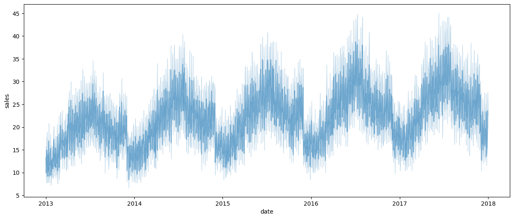
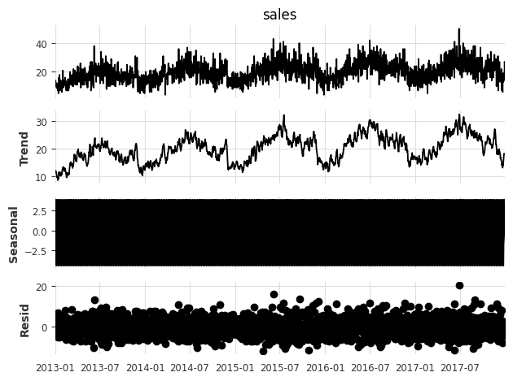
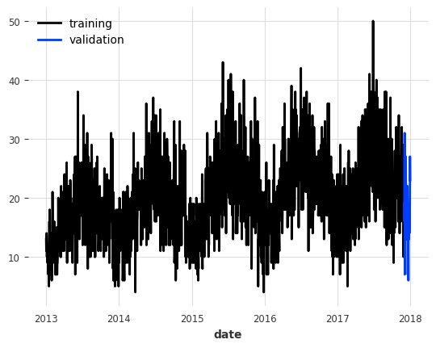
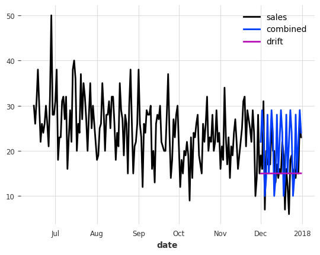
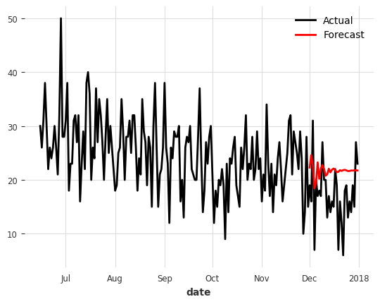
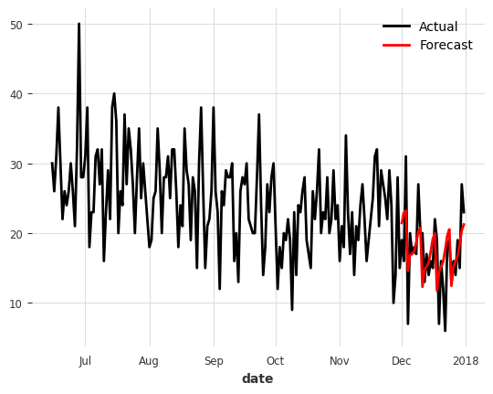
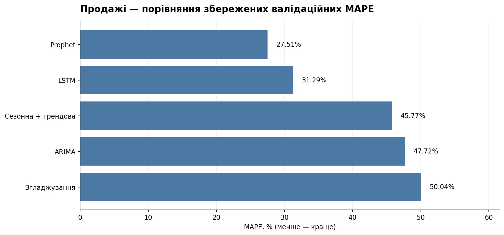
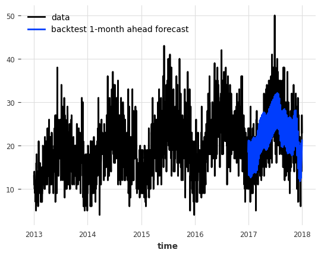

# Попит у магазинах: прогнозування добових продажів

## Підсумок дослідження

**Питання:** як прогнозувати кількість проданих одиниць товару, щоб обґрунтованіше планувати поповнення запасів?

**Підхід:** аналіз ряду товару №1 у магазині №1, базова сезонна модель та порівняння ARIMA, Prophet, LSTM й інших методів.

**Результат зі збереженого виконання:** Prophet — **MAPE 27,51%** на валідації. Значення наведено лише для конкретного ряду та експерименту.

## Дизайн експерименту

**Набір:** Store Item Demand Forecasting Challenge (Kaggle). **Загальний датасет:** 50 товарів × 10 магазинів. **Ряд дослідження:** товар 1 / магазин 1. **Часова валідація:** від грудня 2017 року. **Метрики:** MAPE на відкладеному періоді та історичний прогноз із горизонтом 30 днів.

## Візуальний огляд результатів

### Динаміка попиту

*Сирі щоденні продажі нестабільні; це ускладнює прогнозування окремого дня.*

### Сезонність та тренд

*Декомпозиція відділяє повторювані коливання від довгострокового руху.*

### Часова валідація

*Раніші дати використовують для навчання, пізніші — для оцінки прогнозу.*

### Базова сезонно-трендова модель

*Проста модель задає мінімальний орієнтир, який має перевершувати складніша модель.*

### Прогноз ARIMA

*Класична авторегресійна модель ураховує часову залежність і перетворення ряду.*

### Прогноз Prophet

*У збереженому порівнянні Prophet дав найменшу MAPE серед наведених методів.*

### Порівняння точності

*Показано MAPE п’яти підходів на збереженому валідаційному відрізку.*

### Бектестинг

*Перевірка місячного горизонту на кількох історичних відрізках показує іншу перспективу стабільності прогнозу.*

## Основні висновки та обмеження

- Для цього товару Prophet має найменшу з наведених MAPE (27,51%), проте помилка все ще суттєва для операційного використання.
- Історичне оцінювання Prophet (21,18% MAPE) має іншу схему перевірки й не є прямою заміною валідаційної метрики.
- Критично важливо повторити аналіз для інших товарів і магазинів та врахувати вартість дефіциту й надлишкових запасів.
- Початковий ноутбук містив пошкоджені метадані й помилки в LSTM; формат виправлено, код уточнено, **повний повторний запуск не проводився**.

## Докладна методологія та вихідні результати

## Огляд дослідження

**Мета:** спрогнозувати попит на товар у конкретному магазині, враховуючи історичні продажі, тижневі коливання, тренд і сезонність. Такий підхід може використовуватися як основа планування поповнення запасів.

**Джерело даних:** [Store Item Demand Forecasting Challenge — Kaggle](https://www.kaggle.com/competitions/demand-forecasting-kernels-only/overview). Набір описує щоденні продажі 50 товарів у 10 магазинах. У наданому ноутбуці основна частина експериментів виконана на *товарі №1 у магазині №1* — ці результати не слід автоматично переносити на всі 500 комбінацій.

**Технології:** Python, Pandas, Seaborn, Matplotlib, Darts, XGBoost, ARIMA, AutoARIMA, Prophet, LSTM.

## 1. Дослідження попиту

Порівнюємо часову динаміку для окремих товарів, щоб зрозуміти, чи схожі сезонність і масштаби продажів. Далі вибираємо один ряд для послідовного порівняння моделей.

*Що бачимо:* добові спостереження мінливі; для прогнозу важливі короткі цикли та довгострокові зміни рівня.

## 2. Декомпозиція ряду

Розклад на тренд, сезонність і залишки допомагає побачити повторювані коливання. Він корисний для розуміння ряду, але сам по собі не гарантує точного прогнозу.

## 3. Часове розділення даних

Модель навчається на історії до **1 грудня 2017 року**, а пізніший фрагмент використано як валідаційний період. Перемішування спостережень тут призвело б до витоку інформації про майбутнє.

## 4. Базовий прогноз і складніші моделі

Початковий орієнтир — комбінація `NaiveSeasonal(K=7)` та `NaiveDrift`, яка враховує тижневий цикл і тренд. Після цього порівнюємо інші підходи.

### Результати зі збереженого виконання

| Модель | MAPE |
|---|---:|
| Наївна сезонна + трендова модель | 45,77% |
| Експоненціальне згладжування | 50,04% |
| ARIMA (p=7, d=1, q=1) | 47,72% |
| Prophet | 27,51% |
| LSTM | 31,29% |

**Інтерпретація:** серед наведених тут результатів Prophet показав найменшу валідаційну помилку. Водночас це результати одного ряду й конкретного розділення, тому вони не доводять перевагу Prophet для всіх товарів.

## 5. Історична оцінка прогнозів

У ноутбуці додатково налаштовано історичне оцінювання для Prophet із горизонтом **30 днів**. Для цього сценарію збережено **MAPE 21,18%** — це інша процедура перевірки, тому її не слід напряму порівнювати з MAPE однієї валідаційної ділянки.

## Практичні висновки

- Важливо порівнювати кожну модель із простим базовим прогнозом, а не оцінювати її ізольовано.
- Похибка у 20–50% може бути неприйнятною для автоматичного поповнення запасів без страхового запасу та додаткових перевірок.
- Для всіх 50 товарів і 10 магазинів потрібна масштабована схема навчання й оцінювання з окремими метриками за групами.
- Перед застосуванням варто перевірити `MAE`, `RMSE`, `WAPE` та витрати бізнесу від недопрогнозування й перепрогнозування.

## Технічна реалізація та відтворення

[Відкрити Jupyter Notebook](retail_demand_forecasting.ipynb).

Вихідний ноутбук читає локальний файл `train.csv.zip`, **якого не було серед завантажених матеріалів**. Його потрібно отримати на Kaggle та покласти поруч із ноутбуком для повторного запуску. Потребуються також бібліотека Darts і сумісні залежності. Код і збережені вихідні обчислення не проходили повного повторного запуску в цьому пакеті.
