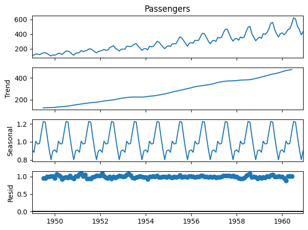
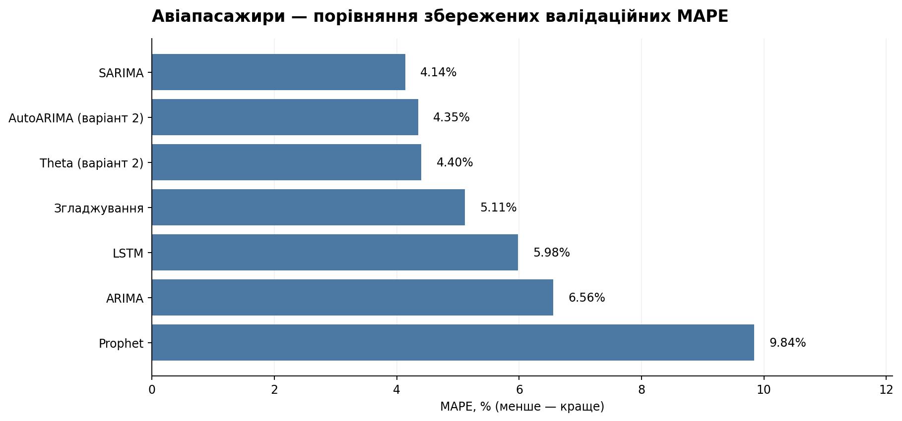
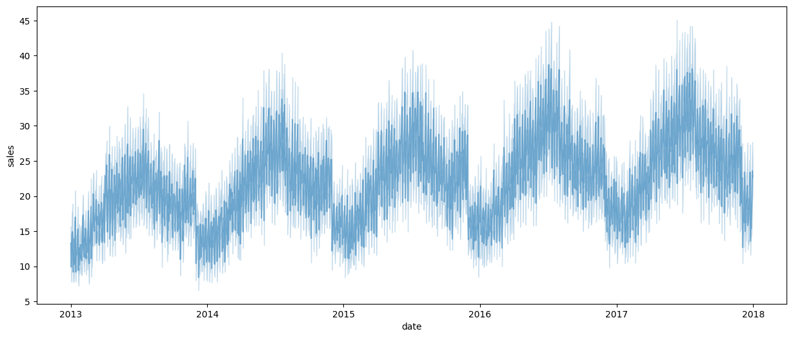
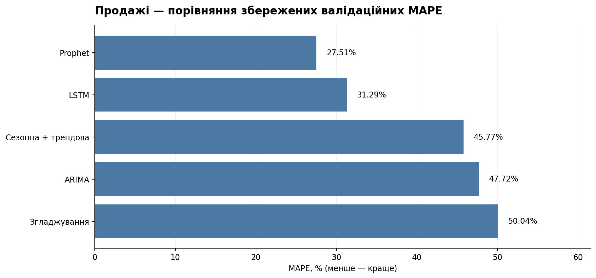

# Аналіз та прогнозування часових рядів

**Два дослідження · 144 місяці авіапасажиропотоку · щоденні продажі в роздрібній торгівлі · 16 візуалізацій**

Часові ряди використовують для прогнозування попиту, навантаження та планування ресурсів. У цих роботах порівнюються класичні статистичні моделі, методи машинного навчання та нейромережеві підходи. Основна увага — **часове розділення, сезонність, точність і перевірка стабільності прогнозу**.

## Ключові результати

| Напрям | Дані | Найменша наведена валідаційна MAPE | Що досліджуємо |
|---|---|---:|---|
| [Авіапасажиропотік](01-airline-passengers/README.md) | 1949–1960, місячна частота | **4,14%** — SARIMA | тренд, річна сезонність, ARIMA, бектестинг |
| [Попит у роздрібній торгівлі](02-retail-demand-forecasting/README.md) | щоденні продажі, товар 1 / магазин 1 | **27,51%** — Prophet | тижневі коливання, базові моделі, складніші підходи |

> Значення метрик узяті зі збережених результатів наданих ноутбуків. Це різні задачі та схеми оцінювання; **порівнювати числа між двома проєктами некоректно**. Після виправлення технічних помилок повне повторне навчання моделей не виконувалося.

## 1. Прогнозування авіапасажиропотоку



Місячні спостереження демонструють зростаючий тренд і сезонні коливання, амплітуда яких збільшується. Тому розглядаємо мультиплікативну декомпозицію та моделі з урахуванням сезонності.



**Результат:** серед наведених збережених експериментів SARIMA досягла найменшої MAPE — 4,14% на валідаційному відрізку. Додатково перевіряємо історичні прогнози й залишки.

[Переглянути дослідження та всі графіки](01-airline-passengers/README.md)

## 2. Прогнозування роздрібного попиту



Попит змінюється нерівномірно. Окремо вивчаємо сезонність, базові прогнози та те, чи покращують їх складніші моделі.



**Результат:** у збереженому порівнянні Prophet має MAPE 27,51%, але ця помилка може бути недостатньою для автоматичного планування запасів без додаткової перевірки на інших товарах і магазинах.

[Переглянути дослідження та всі графіки](02-retail-demand-forecasting/README.md)

## Методика досліджень

1. **Огляд даних:** частота, пропуски, викиди, тренд і сезонність.
2. **Декомпозиція:** відділення трендової, сезонної та залишкової компонент.
3. **Часове розділення:** модель навчається на минулому, прогноз перевіряється на майбутньому.
4. **Базовий прогноз:** складні моделі порівнюємо з простими сезонними або трендовими методами.
5. **Оцінка похибки:** MAPE та візуальне порівняння фактичних і прогнозованих значень.
6. **Бектестинг:** перевірка прогнозів на кількох історичних відрізках.
7. **Аналіз залишків:** пошук систематичних відхилень, які метрика приховує.

## Технології

`Python` · `Pandas` · `NumPy` · `Matplotlib` · `Statsmodels` · `Darts` · `Scikit-learn` · `Prophet` · `XGBoost` · `LSTM`

## Структура

```text
04-time-series/
├── README.md
├── requirements.txt
├── 01-airline-passengers/
│   ├── README.md
│   ├── airline_passengers_analysis.ipynb
│   └── figures/ (8 графіків)
└── 02-retail-demand-forecasting/
    ├── README.md
    ├── retail_demand_forecasting.ipynb
    └── figures/ (8 графіків)
```

## Відтворення та обмеження

- Для авіапасажиропотоку використовується [відкритий CSV](https://raw.githubusercontent.com/jbrownlee/Datasets/master/airline-passengers.csv).
- Для продажів потрібен `train.csv.zip` із [Kaggle Store Item Demand Forecasting Challenge](https://www.kaggle.com/competitions/demand-forecasting-kernels-only/data). Він не входить до цього архіву.
- Ноутбуки перевірені на відповідність формату Jupyter; пошкоджені метадані віджетів прибрані. Проблемний блок прогнозу LSTM у дослідженні продажів виправлено, але повторне навчання LSTM і повний запуск обох ноутбуків **не виконувалися**.
- Результати — з історичних навчальних експериментів. Для реальної експлуатації необхідні повторне оцінювання на нових даних, контроль дрейфу та витрат помилок.
