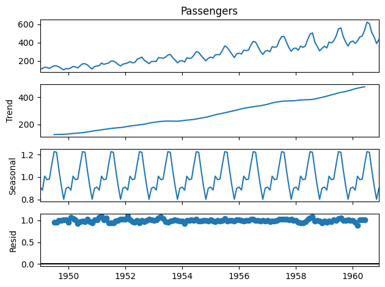
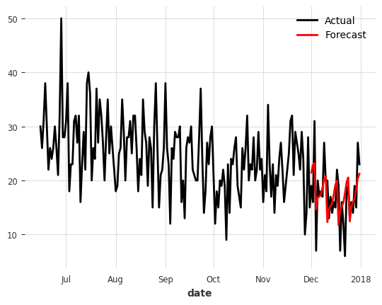

# Прогнозування часових рядів | Time Series Forecasting

## Портфоліо досліджень

Часовий ряд — це спостереження, для яких **порядок і дата мають значення**. У цих двох проєктах я досліджую, як із минулих значень побудувати перевірюваний прогноз і оцінити його корисність для планування.

| Дослідження | Бізнес-завдання | Ключові методи | Приклад результату |
|---|---|---|---|
| [Авіапасажиропотік](01-airline-passengers/) | Оцінити майбутнє навантаження | Декомпозиція, ARIMA/SARIMA, Darts, бектестинг | SARIMA: MAPE 4,14% на валідації |
| [Попит у магазинах](02-retail-demand-forecasting/) | Прогнозувати поповнення запасів | Наївні моделі, ARIMA, Prophet, LSTM | Prophet: MAPE 27,51% на валідації |

*Метрики наведені за збереженими результатами конкретних експериментів у вихідних ноутбуках, не як незалежний тест моделей.*

## 01. Сезонність авіапасажиропотоку



Помітний довгостроковий тренд та сезонні коливання. Щоб модель прогнозувала осмислено, ці компоненти слід враховувати й оцінювати на майбутніх періодах.

[Детальне дослідження: авіапасажиропотік](01-airline-passengers/README.md)

## 02. Прогнозування продажів



Добові продажі зазнають значних коливань. Тут важливі тижнева сезонність і перевірка моделей на відкладеному часовому інтервалі.

[Детальне дослідження: попит у магазинах](02-retail-demand-forecasting/README.md)

## Як оцінюється якість

1. **Часове розділення:** тренування тільки на минулих спостереженнях.
2. **Базова модель:** відправна точка для перевірки, чи складна модель справді краща.
3. **MAPE:** середня відносна помилка, якщо фактичні значення не близькі до нуля.
4. **Бектестинг:** повторна симуляція прогнозів з різних історичних дат.
5. **Залишки:** перевірка систематичних помилок, які одна метрика може приховати.

## Структура проєкту

```text
04-time-series/
├── README.md
├── 01-airline-passengers/
│   ├── README.md
│   ├── airline_passengers_analysis.ipynb
│   └── figures/
└── 02-retail-demand-forecasting/
    ├── README.md
    ├── retail_demand_forecasting.ipynb
    └── figures/
```

## Відтворюваність і межі

Це оформлені дослідження на основі наданих ноутбуків із збереженими результатами. Дані про авіапасажирів завантажуються з відкритого CSV, а датасет продажів потрібно окремо завантажити з Kaggle. Складні залежності Darts/Prophet/RNN можуть потребувати окремого середовища. Повне повторне виконання експериментів у межах підготовки цього пакета не проводилося.
