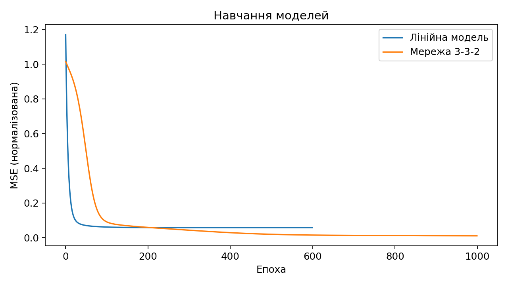
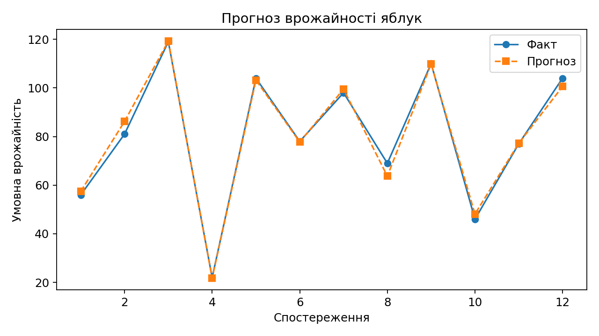
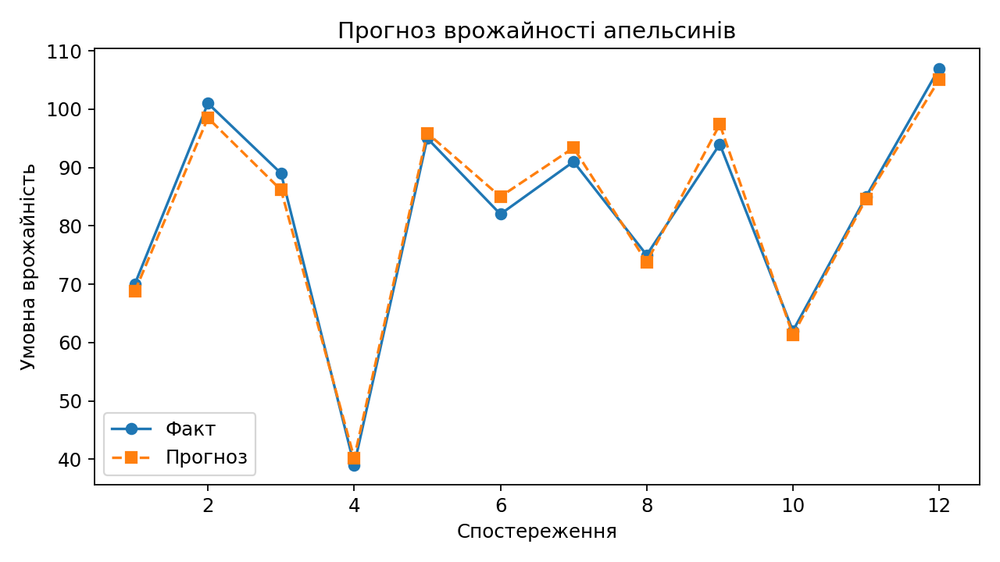
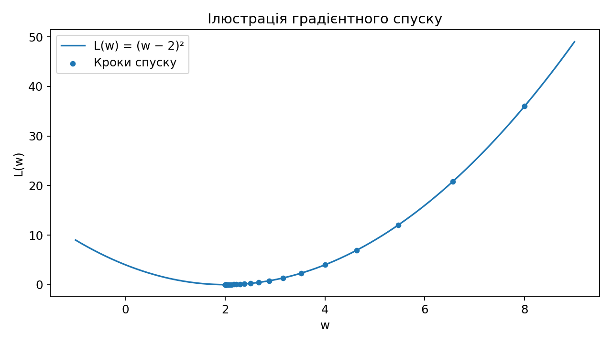
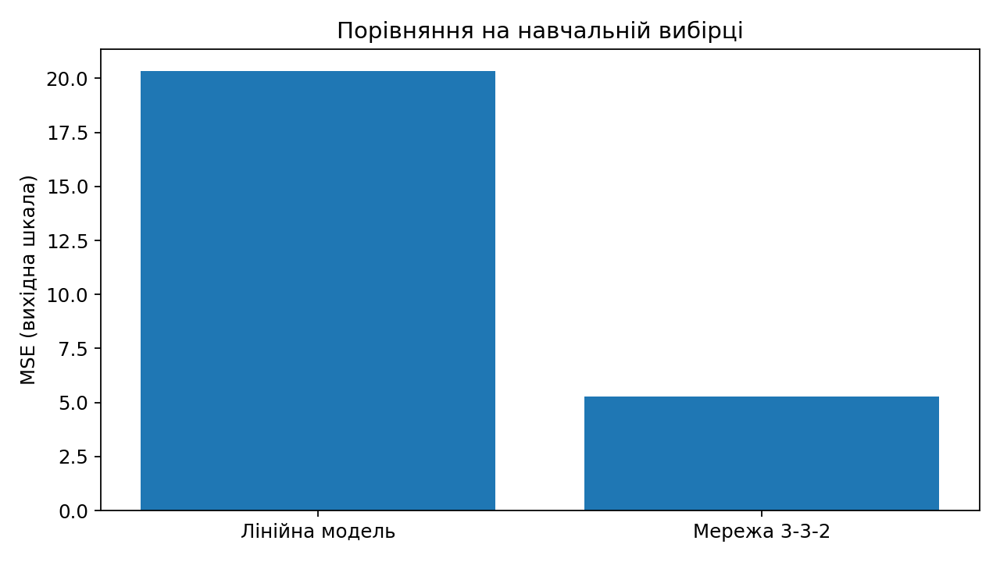

# 01. Основи PyTorch: від тензорів до нейромережі

Навчальний проєкт українською мовою для GitHub-портфоліо.

## Що вивчаємо
- Тензори PyTorch, форми та обчислення
- Автоматичне диференціювання (`autograd`)
- Функція втрат MSE та градієнтний спуск
- Прогнозування врожайності яблук і апельсинів за трьома погодними ознаками
- Лінійний шар `nn.Linear`
- Нейромережа 3 → 3 → 2 із ReLU
- Порівняння прогнозів із фактичними значеннями

## Запуск

```bash
python -m venv .venv
# Windows:
.venv\Scripts\activate
# macOS/Linux:
source .venv/bin/activate
pip install -r requirements.txt
jupyter lab
```

Відкрийте `pytorch_fundamentals.ipynb` та виконайте комірки послідовно. Для Google Colab достатньо завантажити файл `.ipynb` — CPU підходить.

## Дані

Невеликий **синтетичний** набір із температурою, опадами, вологістю та умовною врожайністю двох культур. Дані навчальні й не відображають реальну агростатистику. Точність на них не варто трактувати як якість прогнозу в реальних умовах.

## Графіки






