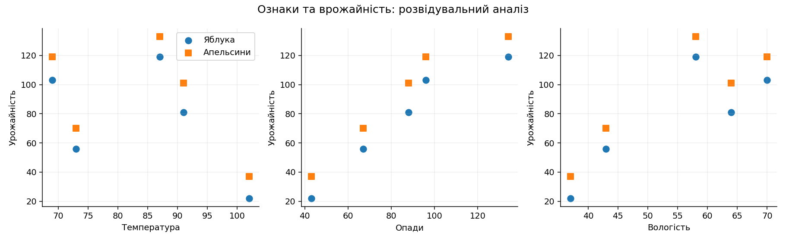
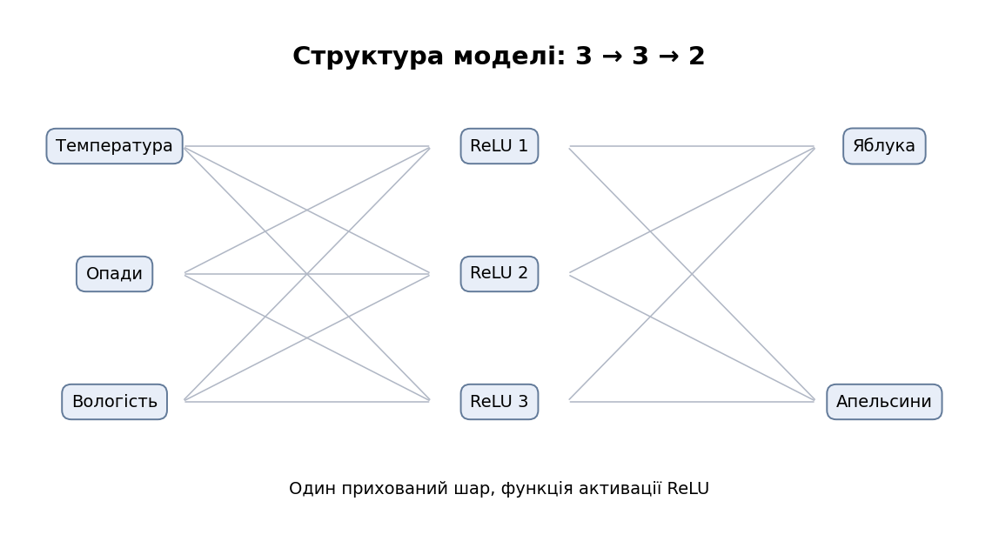

# Прогнозування врожайності

> **Від даних до нейромережі.** Температура, опади та вологість допомагають отримати два прогнози — для яблук і апельсинів.

**Інструменти:** Python · PyTorch · NumPy · Matplotlib · Jupyter Notebook  
**Код і результати:** [`pytorch_fundamentals.ipynb`](pytorch_fundamentals.ipynb)

## Ідея дослідження

Чи можна оцінити майбутню врожайність одразу двох культур за погодними параметрами? На прикладі невеликого набору спостережень покроково реалізовано модель: від тензорів та обчислення похідних до оновлення ваг. Навчальна вибірка містить лише **5 унікальних записів**; цей експеримент демонструє механіку навчання, а не придатність до реального агропрогнозування.

**Вхід:** температура, опади, вологість. **Вихід:** прогноз для яблук та апельсинів. **Мета:** мінімізувати середньоквадратичну помилку (MSE).

## Результат: дивимося не лише на код

### Що з цього випливає

- Показує зміну функції втрат під час навчання.
- Мала навчальна вибірка не гарантує точності на нових даних.

## Як побудовано експеримент

1. **Вхідні дані.** Перетворюємо спостереження або послідовності у тензори.
2. **Модель.** Визначаємо шари, параметри та логіку прямого проходу.
3. **Навчання.** Обчислюємо втрати, градієнти та оновлюємо ваги.
4. **Оцінювання.** Аналізуємо доступні графіки та характер помилок.
5. **Інтерпретація.** Формулюємо, що демонструє дослід і чого він ще не доводить.

## Додаткові графіки зі збереженого запуску

**Візуалізація 1** — додатковий результат із ноутбука.

**Візуалізація 2** — додатковий результат із ноутбука.

**Візуалізація 3** — додатковий результат із ноутбука.

**Візуалізація 4** — додатковий результат із ноутбука.

## Відтворення

Відкрийте ноутбук у Google Colab або Jupyter, встановіть залежності з [кореневого `requirements.txt`](../requirements.txt) і виконайте комірки послідовно. Для RNN-експериментів потрібні файли навчальних категорій імен; для них у ноутбуках передбачене завантаження за наявності інтернету.

**Про достовірність результатів.** Візуалізації походять зі збережених запусків; нові показники якості моделей не обчислювалися. Повний повторний запуск усіх комірок не підтверджено. Для прикладного використання слід перевірити відтворюваність і якість на незалежних даних.
