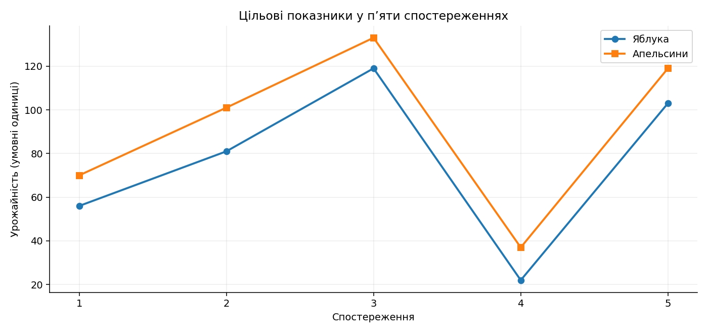
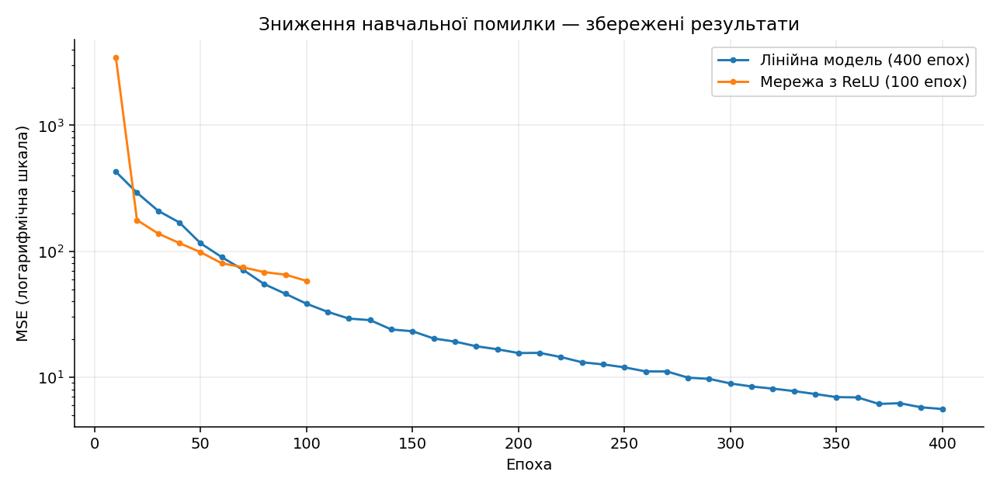
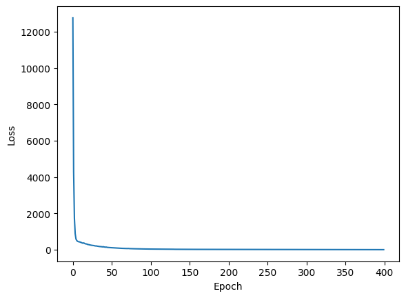

# Прогнозування врожайності за допомогою PyTorch

> **Тема:** автоматичне диференціювання, градієнтний спуск, лінійна регресія та нейронна мережа прямого поширення.
>
> **Стек:** Python · NumPy · PyTorch · Matplotlib · Jupyter Notebook.

## Огляд дослідження

У цьому проєкті досліджено, як побудувати модель, що одночасно прогнозує **врожайність яблук та апельсинів** на основі трьох параметрів середовища: температури, кількості опадів і вологості.

Робота побудована як послідовність експериментів: від тензорів і автоматичного диференціювання до власного градієнтного спуску, стандартних інструментів PyTorch та мережі з прихованим шаром.

**Головний результат:** показано повний механізм навчання з мінімізації MSE; графіки демонструють, як знижується помилка на навчальних спостереженнях. Це демонстраційний експеримент, а не готова модель прогнозування реального врожаю.

## 1. Дані та постановка задачі

| Складова | Опис |
|---|---|
| Ознаки (X) | Температура, опади, вологість |
| Цілі (y) | Урожайність яблук і апельсинів |
| Вихідна вибірка | 5 унікальних спостережень |
| Навчальний експеримент через DataLoader | 15 рядків, отриманих повторенням початкових п’яти прикладів |
| Тип задачі | Багатовихідна регресія |
| Основна метрика навчання | MSE — середньоквадратична помилка |



*Рис. 1.* Порівняння значень урожайності обох культур у початкових п’яти спостереженнях. Дані не є незалежною репрезентативною вибіркою для оцінювання якості прогнозування.


*Рис. 2.* Як урожайність співвідноситься з температурою, опадами та вологістю. Це описові залежності; п’яти спостережень недостатньо для стійких висновків про вплив факторів.

## 2. Тензори та автоматичне диференціювання

PyTorch використовує **тензори** — багатовимірні структури чисел — і автоматично обчислює градієнти операцій над ними, якщо увімкнено `requires_grad=True`.

Для простого виразу `y = wx + b` виклик `backward()` дає похідні за параметрами `w` і `b`. Саме ці похідні дозволяють визначити напрямок зміни параметрів, щоб зменшити похибку моделі.

## 3. Лінійна регресія з нуля

Перший підхід використовує матрицю ваг `W` та вектор зміщень `b`. Модель обчислює два прогнози одночасно:

```python
def model(x, w, b):
    return x @ w.t() + b
```

Функція втрат — **MSE**, тобто середнє значення квадратів різниць між прогнозом і фактом. Навчання реалізовано вручну: прогноз → MSE → `backward()` → оновлення ваг → очищення градієнтів.

Тут важливо не плутати зменшення **навчальної** MSE із перевіреною точністю на нових даних: незалежна тестова вибірка у вихідному прикладі відсутня.

## 4. PyTorch: DataLoader, nn.Linear, SGD

Другий підхід застосовує стандартні компоненти бібліотеки:

- `TensorDataset` і `DataLoader` — подача даних мініпакетами;
- `nn.Linear(3, 2)` — лінійний шар із трьома входами та двома виходами;
- `torch.optim.SGD` — стохастичний градієнтний спуск;
- `torch.nn.functional.mse_loss` — функція втрат;
- 400 епох навчання лінійної моделі.



*Рис. 3.* Навчальні MSE за збереженими журналами експериментів. Використано логарифмічну шкалу по вертикалі; криві побудовані лише для зафіксованих епох. Порівнювати їх як незалежний бенчмарк не можна: різняться початкові ваги й кількість епох.

## 5. Нейронна мережа з прихованим шаром

Після лінійної моделі досліджено **feed-forward neural network**, яка має архітектуру `3 → 3 → 2`: три вхідні характеристики, три нейрони прихованого шару та два прогнозовані значення.


*Рис. 4.* Схематична архітектура з одним прихованим шаром та нелінійною активацією **ReLU**. Це схема коду `SimpleNet`, а не графік реальних ваг моделі.

```python
class SimpleNet(nn.Module):
    def __init__(self):
        super().__init__()
        self.linear1 = nn.Linear(3, 3)
        self.act1 = nn.ReLU()
        self.linear2 = nn.Linear(3, 2)

    def forward(self, x):
        return self.linear2(self.act1(self.linear1(x)))
```

Вихідний ноутбук навчає цю модель 100 епох із SGD і MSE. Нелінійна активація дозволяє моделі представляти складніші зв'язки, ніж одна лінійна трансформація, але на цій маленькій вибірці перевагу архітектури не доведено.

## 6. Аналіз процесу навчання



*Рис. 5.* Оригінальна крива втрат із збережених результатів ноутбука. Вона показує динаміку оптимізації під час навчання, але не якість прогнозування на незалежних даних.

У роботі демонструються три принципові речі: градієнти обчислюються автоматично, оптимізатор оновлює параметри моделі, а функція втрат відстежує наближення прогнозів до цільових значень.

## 7. Висновки та обмеження

1. Побудовано багатовихідну регресію на базових операціях PyTorch та через `nn.Linear`.
2. Продемонстровано навчання SGD і використання MSE.
3. Створено просту нейронну мережу з ReLU для тих самих цільових змінних.
4. Через лише **5 унікальних спостережень**, повторення рядків і відсутність тестової вибірки не можна стверджувати, що отримані моделі здатні надійно прогнозувати врожайність у реальних умовах.
5. Наступним покращенням є збирання більшого датасету, поділ на train/validation/test, нормалізація ознак та порівняння з наївним базовим прогнозом.

## 8. Відтворення результатів

Відкрийте [ноутбук](pytorch_fundamentals.ipynb) у Jupyter або Google Colab. Для виконання потрібні `numpy`, `torch`, `matplotlib` (див. `requirements.txt`). Запускайте комірки послідовно. Частина результатів залежить від випадкової ініціалізації та порядку мініпакетів.

> Матеріал адаптований із попереднього навчального ноутбука. Збережені outputs не є результатом нового повного тестового прогону після оформлення.
