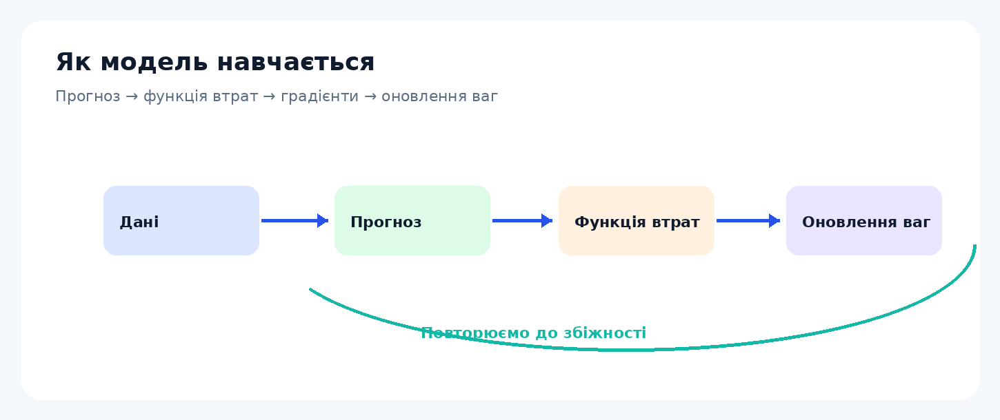
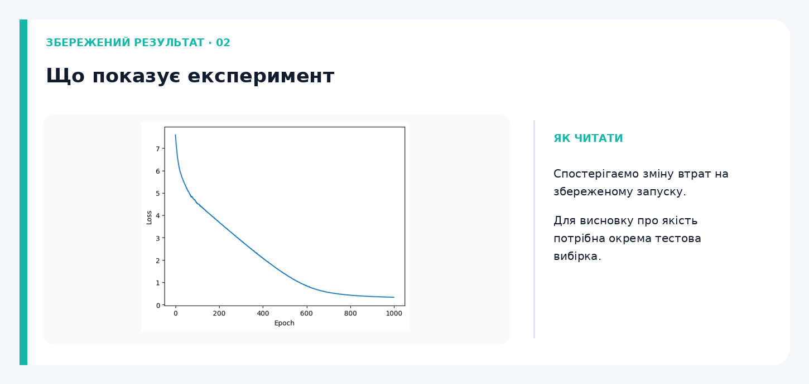

# Як навчається модель

> **Логістична регресія у PyTorch.** Вивчаємо, як працюють градієнти, оптимізація та бінарна класифікація — від реалізації вручну до torch.nn.

**Інструменти:** Python · PyTorch · NumPy · Matplotlib · Jupyter Notebook  
**Код і результати:** [`nn_training.ipynb`](nn_training.ipynb)

## Ідея дослідження

Що змінюється всередині моделі під час навчання? Спочатку формується прогноз, далі обчислюється похибка, виконується зворотне поширення градієнтів, після чого оптимізатор змінює параметри. Цей цикл дозволяє зрозуміти, як реалізація через `torch.nn` співвідноситься з ручними математичними обчисленнями.

**Фокус:** сигмоїда, бінарна крос-ентропія, градієнтний спуск, цикл тренування.

## Результат: дивимося не лише на код

### Що з цього випливає

- Спостерігаємо зміну втрат на збереженому запуску.
- Для висновку про якість потрібна окрема тестова вибірка.

## Як побудовано експеримент

1. **Вхідні дані.** Перетворюємо спостереження або послідовності у тензори.
2. **Модель.** Визначаємо шари, параметри та логіку прямого проходу.
3. **Навчання.** Обчислюємо втрати, градієнти та оновлюємо ваги.
4. **Оцінювання.** Аналізуємо доступні графіки та характер помилок.
5. **Інтерпретація.** Формулюємо, що демонструє дослід і чого він ще не доводить.

## Додаткові графіки зі збереженого запуску

**Візуалізація 1** — додатковий результат із ноутбука.

## Відтворення

Відкрийте ноутбук у Google Colab або Jupyter, встановіть залежності з [кореневого `requirements.txt`](../requirements.txt) і виконайте комірки послідовно. Для RNN-експериментів потрібні файли навчальних категорій імен; для них у ноутбуках передбачене завантаження за наявності інтернету.

**Про достовірність результатів.** Візуалізації походять зі збережених запусків; нові показники якості моделей не обчислювалися. Повний повторний запуск усіх комірок не підтверджено. Для прикладного використання слід перевірити відтворюваність і якість на незалежних даних.
