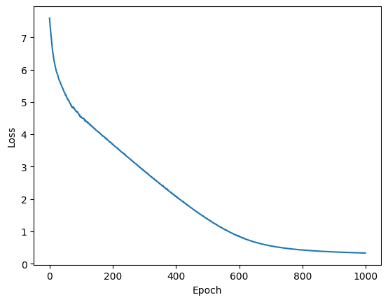

# Навчання нейромереж у PyTorch: бінарна класифікація

## Про дослідження

Ручна реалізація логістичної регресії та аналогічна модель через torch.nn. Демонстрація тензорів, градієнтів і навчального циклу.

Цей матеріал демонструє роботу з нейронними мережами на рівні коду: підготовка даних, визначення моделі, навчання, інтерпретація прогнозів і аналіз помилок. Основна мета — показати принципи реалізації, а не заявити про готову виробничу систему.

## Постановка задачі

Для набору метеорологічних спостережень оцінити ймовірність перевищення заданого порогу врожайності яблук. Порівняти ручне обчислення прогнозу й функції втрат із реалізацією через `torch.nn`.

**Методи:** бінарна класифікація, сигмоїда, binary cross-entropy, градієнтний спуск, DataLoader.

## Хід роботи

1. Підготовка даних і перетворення на тензори.
2. Опис математичної моделі та обчислення прогнозів.
3. Налаштування функції втрат і оптимізатора.
4. Навчання та візуальна перевірка процесу оптимізації.
5. Аналіз результатів і типових помилок.

## Візуальні результати

Нижче наведено **зображення зі збережених результатів вихідного ноутбука**, а не графіки, згенеровані за новими даними.

### Візуалізація 1

*Графік зі збереженого виконання ноутбука (комірка 42). Для точного тлумачення використовуйте підписи осей та код відповідної комірки.*

## Інтерпретація та висновки

- Нейронна мережа навчається шляхом поступової зміни ваг за градієнтами функції втрат.
- Зменшення втрат на навчальній вибірці саме по собі не підтверджує якість на нових даних.
- Для порівняння архітектур потрібні однакові розбиття даних, метрики й протокол експерименту.
- У випадку класифікації імен матриця помилок показує, які категорії модель найчастіше плутає.

## Технічна реалізація

- **Ноутбук:** [`nn_training.ipynb`](nn_training.ipynb)
- **Бібліотеки, що зустрічаються в коді:** `torch`, `numpy`, `matplotlib`.

## Відтворення

1. Відкрийте ноутбук у Google Colab або Jupyter.
2. Установіть потрібні пакети з `requirements.txt` у корені `05-deep-learning`.
3. Виконуйте комірки послідовно. Для RNN потрібні текстові файли категорій імен.
4. Порівняйте отримані результати зі збереженим виконанням.

**Обмеження:** це демонстраційні дослідження. Збережені графіки не є доказом відтворюваності. Повне перенавчання всіх моделей у межах підготовки архіву не проводилося.
