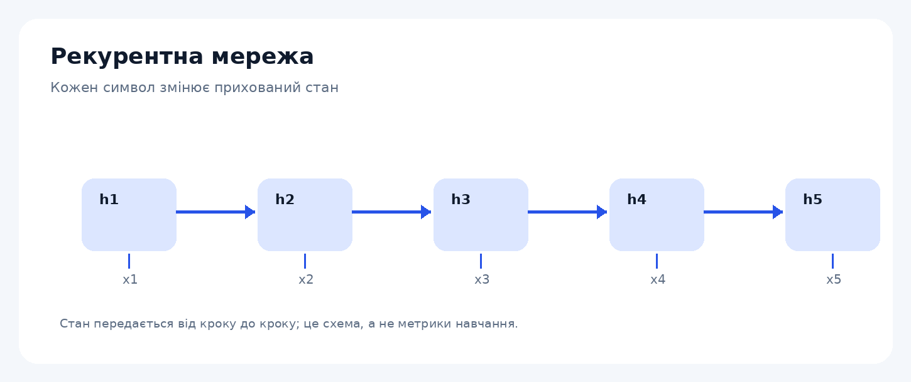
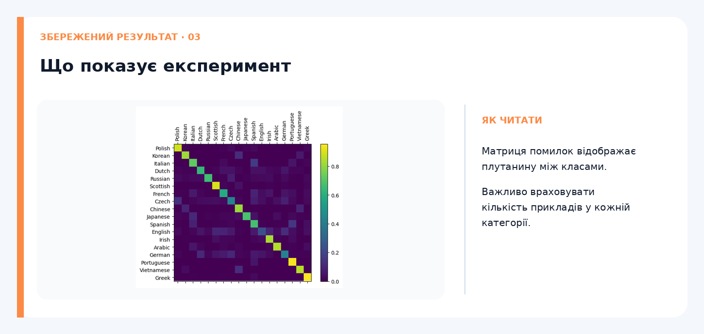
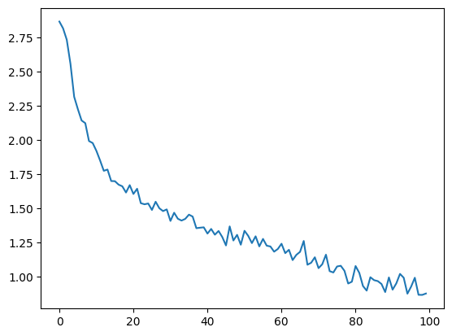

# Пам’ять із символів

> **Рекурентна мережа власноруч.** Мережа читає ім’я посимвольно й намагається передбачити мовну категорію на основі накопиченого контексту.

**Інструменти:** Python · PyTorch · NumPy · Matplotlib · Jupyter Notebook  
**Код і результати:** [`rnn_from_scratch.ipynb`](rnn_from_scratch.ipynb)

## Ідея дослідження

Звичайна таблична модель не пам’ятає попередніх символів. Тут RNN послідовно читає літери імені й оновлює прихований стан. Після останнього символу стан використовується для прогнозу мовної категорії.

**Фокус:** кодування символів, стан RNN, навчання, матриця помилок.

## Результат: дивимося не лише на код

### Що з цього випливає

- Матриця помилок відображає плутанину між класами.
- Важливо враховувати кількість прикладів у кожній категорії.

## Як побудовано експеримент

1. **Вхідні дані.** Перетворюємо спостереження або послідовності у тензори.
2. **Модель.** Визначаємо шари, параметри та логіку прямого проходу.
3. **Навчання.** Обчислюємо втрати, градієнти та оновлюємо ваги.
4. **Оцінювання.** Аналізуємо доступні графіки та характер помилок.
5. **Інтерпретація.** Формулюємо, що демонструє дослід і чого він ще не доводить.

## Додаткові графіки зі збереженого запуску

**Візуалізація 1** — додатковий результат із ноутбука.

**Візуалізація 2** — додатковий результат із ноутбука.

## Відтворення

Відкрийте ноутбук у Google Colab або Jupyter, встановіть залежності з [кореневого `requirements.txt`](../requirements.txt) і виконайте комірки послідовно. Для RNN-експериментів потрібні файли навчальних категорій імен; для них у ноутбуках передбачене завантаження за наявності інтернету.

**Про достовірність результатів.** Візуалізації походять зі збережених запусків; нові показники якості моделей не обчислювалися. Повний повторний запуск усіх комірок не підтверджено. Для прикладного використання слід перевірити відтворюваність і якість на незалежних даних.
