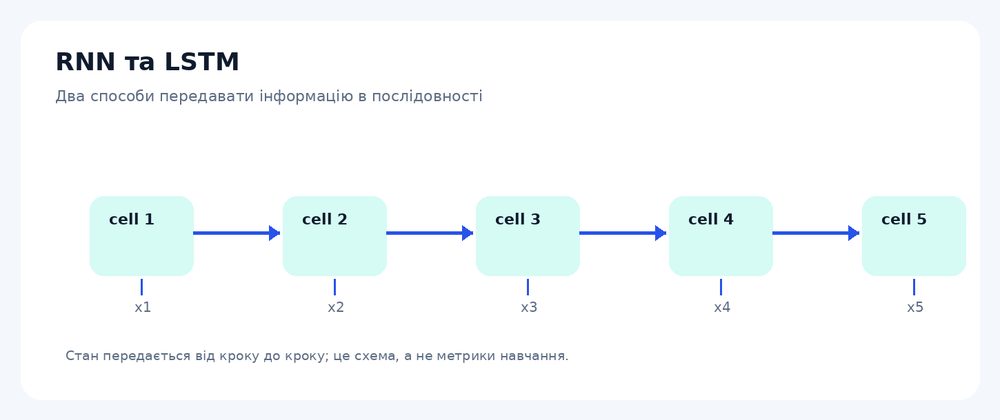
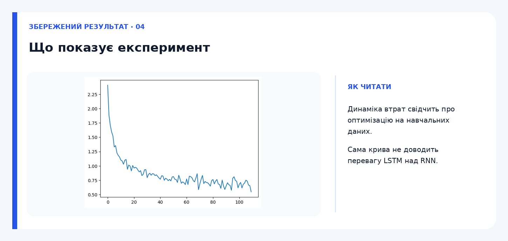
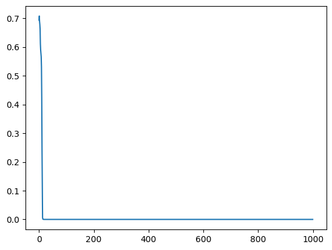
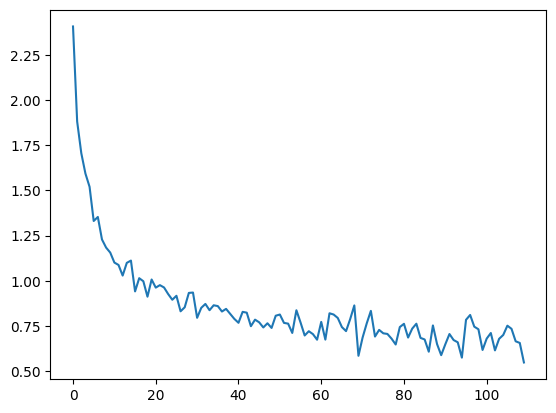
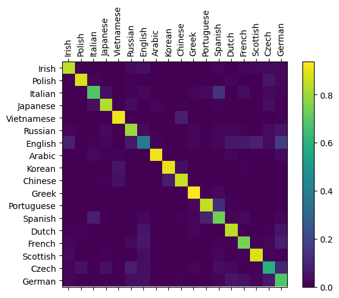

# Пам’ять у послідовностях

> **RNN і LSTM у PyTorch.** Порівнюємо підходи до обробки послідовностей і дивимося, як змінюється навчання рекурентних моделей.

**Інструменти:** Python · PyTorch · NumPy · Matplotlib · Jupyter Notebook  
**Код і результати:** [`rnn_lstm_pytorch.ipynb`](rnn_lstm_pytorch.ipynb)

## Ідея дослідження

У задачах із послідовностями інформація із попередніх кроків може бути важливою. У роботі реалізовано рекурентні архітектури засобами PyTorch та досліджено поведінку процесу навчання. LSTM використовує механізми керування пам’яттю, проте перевагу архітектури треба перевіряти за однаковим протоколом експерименту.

**Фокус:** PyTorch RNN, LSTM, оптимізатори, аналіз кривих втрат і помилок.

## Результат: дивимося не лише на код

### Що з цього випливає

- Динаміка втрат свідчить про оптимізацію на навчальних даних.
- Сама крива не доводить перевагу LSTM над RNN.

## Як побудовано експеримент

1. **Вхідні дані.** Перетворюємо спостереження або послідовності у тензори.
2. **Модель.** Визначаємо шари, параметри та логіку прямого проходу.
3. **Навчання.** Обчислюємо втрати, градієнти та оновлюємо ваги.
4. **Оцінювання.** Аналізуємо доступні графіки та характер помилок.
5. **Інтерпретація.** Формулюємо, що демонструє дослід і чого він ще не доводить.

## Додаткові графіки зі збереженого запуску

**Візуалізація 1** — додатковий результат із ноутбука.

**Візуалізація 2** — додатковий результат із ноутбука.

**Візуалізація 3** — додатковий результат із ноутбука.

## Відтворення

Відкрийте ноутбук у Google Colab або Jupyter, встановіть залежності з [кореневого `requirements.txt`](../requirements.txt) і виконайте комірки послідовно. Для RNN-експериментів потрібні файли навчальних категорій імен; для них у ноутбуках передбачене завантаження за наявності інтернету.

**Про достовірність результатів.** Візуалізації походять зі збережених запусків; нові показники якості моделей не обчислювалися. Повний повторний запуск усіх комірок не підтверджено. Для прикладного використання слід перевірити відтворюваність і якість на незалежних даних.
