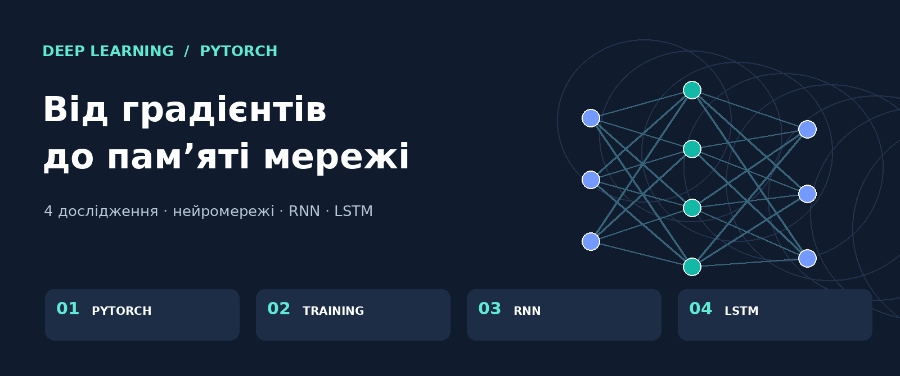
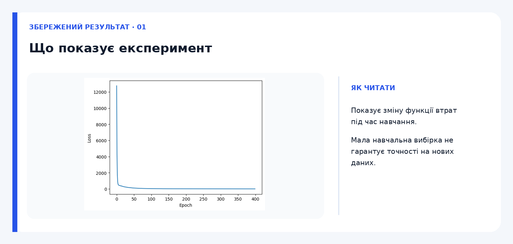
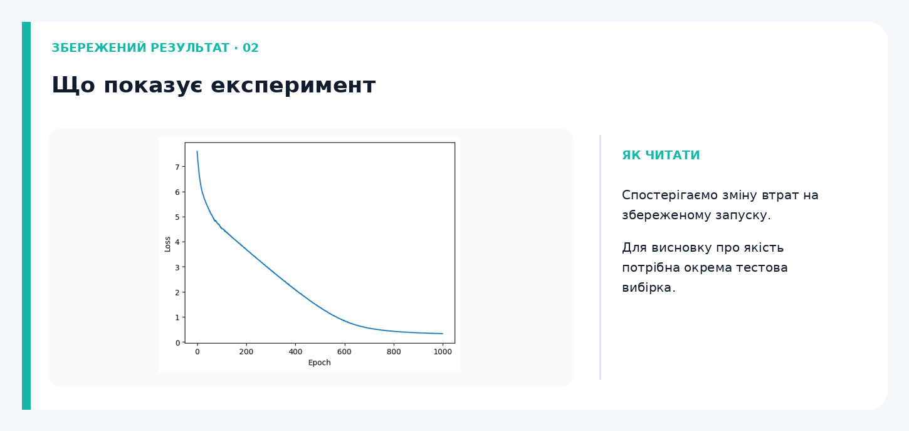
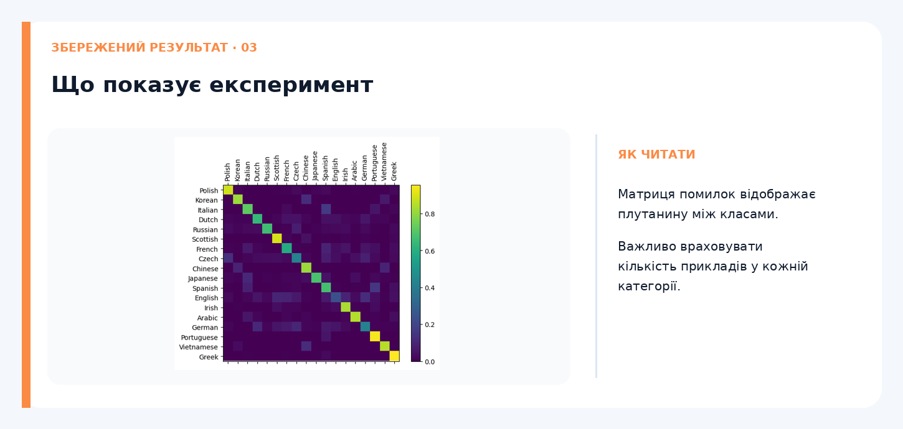
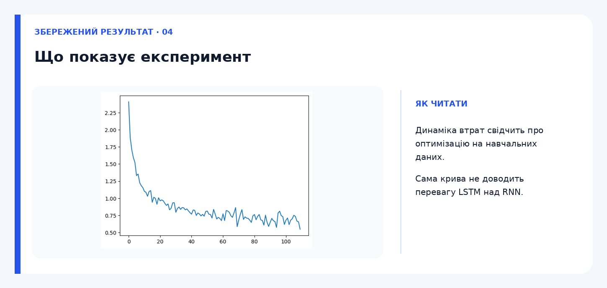

# Deep Learning · від першого тензора до RNN і LSTM

**Як навчити модель бачити закономірності, а потім навчити її враховувати послідовність?** Ця колекція досліджень показує шлях від багатовихідної регресії через PyTorch до рекурентних моделей, які обробляють текст символ за символом.

Тут не просто набір ноутбуків: кожне дослідження має власну задачу, схему рішення, реальні збережені результати й технічний код.

## Маршрут досліджень

| Проєкт | Запитання | Результат, який можна побачити |
|---|---|---|
| [01 · Основи PyTorch](01-pytorch-fundamentals/) | Як навчити модель прогнозувати два показники? | Модель і криві навчання |
| [02 · Навчання моделі](02-neural-network-training/) | Звідки беруться градієнти і як змінюються ваги? | Функція втрат у процесі оптимізації |
| [03 · RNN із нуля](03-rnn-from-scratch/) | Як розпізнавати категорію імені за буквами? | Помилки між класами та навчання |
| [04 · RNN / LSTM](04-rnn-lstm-pytorch/) | Як зберігати інформацію між кроками? | Поведінка рекурентних моделей |

## Чотири експерименти — чотири різні задачі

### 01 · [Прогнозування врожайності](01-pytorch-fundamentals/)

Температура, опади та вологість допомагають отримати два прогнози — для яблук і апельсинів.

### 02 · [Як навчається модель](02-neural-network-training/)

Вивчаємо, як працюють градієнти, оптимізація та бінарна класифікація — від реалізації вручну до torch.nn.

### 03 · [Пам’ять із символів](03-rnn-from-scratch/)

Мережа читає ім’я посимвольно й намагається передбачити мовну категорію на основі накопиченого контексту.

### 04 · [Пам’ять у послідовностях](04-rnn-lstm-pytorch/)

Порівнюємо підходи до обробки послідовностей і дивимося, як змінюється навчання рекурентних моделей.

## Що демонструють ці роботи

- Роботу з тензорами, автоматичним диференціюванням та функціями втрат.
- Принципи оптимізації ваг і побудови циклу навчання.
- Рекурентні архітектури, що накопичують інформацію в прихованому стані.
- Візуальний аналіз навчання й типових помилок моделей.

## Технічна частина

**Стек:** Python · PyTorch · NumPy · Matplotlib · Jupyter. У кожному каталозі є `.ipynb`, окремий README й папка `figures/`. Для запуску потрібні залежності з [`requirements.txt`](requirements.txt).

**Примітка:** представлені результати — збережені виходи вихідних навчальних ноутбуків. Вони не є новою незалежною оцінкою якості та не означають готовності моделей до продакшену. Схеми архітектур спеціально створені для пояснення методів, а не як виміряні результати.
