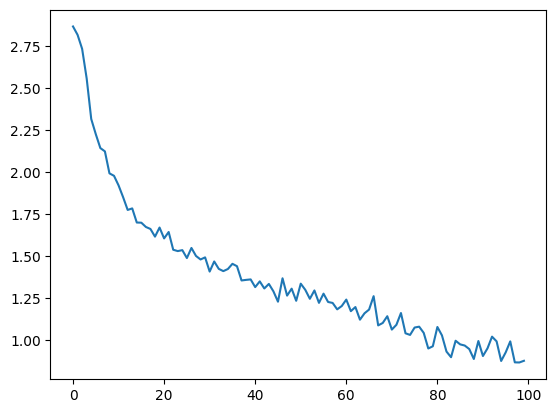
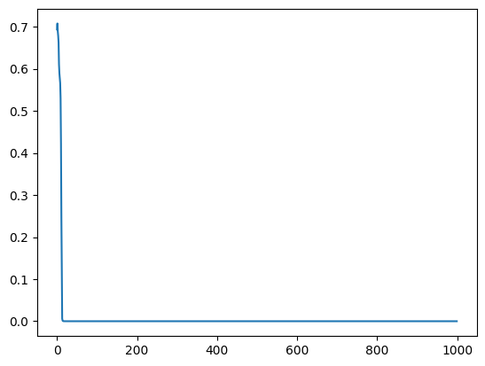

# Deep Learning — нейронні мережі на Python

Колекція досліджень із PyTorch: від тензорів та автоматичного диференціювання до рекурентних нейронних мереж. Для кожної теми подано постановку задачі, технічний ноутбук і збережені результати візуалізації.

## Проєкти

| № | Дослідження | Основні поняття |
|---|---|---|
| 01 | [Основи PyTorch](01-pytorch-fundamentals/) | Тензори, градієнти, лінійна регресія, feed-forward мережі |
| 02 | [Навчання нейромереж](02-neural-network-training/) | Бінарна класифікація, сигмоїда, BCE, градієнтний спуск |
| 03 | [RNN із нуля](03-rnn-from-scratch/) | Послідовності символів, прихований стан, класифікація імен |
| 04 | [RNN і LSTM у PyTorch](04-rnn-lstm-pytorch/) | Рекурентні моделі, LSTM, оптимізація, аналіз помилок |

## Візуальні результати

### 02-neural-network-training

### 03-rnn-from-scratch

### 04-rnn-lstm-pytorch

## Організація досліджень

У кожній папці є короткий аналітичний огляд українською й Jupyter Notebook. Серед інструментів: **Python, PyTorch, NumPy, Matplotlib**. Практичні результати походять із навчальних досліджень; для застосування моделей у реальних задачах потрібні контрольована валідація, перевірка узагальнення та повторний запуск.

## Наступні напрями

Потенційне продовження: CNN для зображень, сучасні моделі обробки текстів та практичне порівняння моделей на тестових даних.
